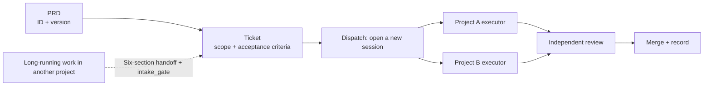

# AI Workspace Kit

中文版：[README.md](README.md)

**A project-management layer for command-line agents. You bring requirements to one PM: it writes the ticket, dispatches it to a fresh session in the right project, watches the receipts, and has a different session review. Nothing merges until review and tests pass.**


[The problem](#the-problem-it-solves) · [What it is](#what-it-is) · [Context boundaries](#context-boundaries) · [Life of a ticket](#the-life-of-one-ticket) · [Gates](#gates-and-decision-points) · [Known limitations](#known-limitations) · [Install](#install) · [Demo](#verification-and-demo)

The workflow has run dozens of tickets in a real project; stripped of project-specific content, it is packaged here at version 0.5.0. It needs Python 3.10+ and an agent host that reads `AGENTS.md`. Dispatch inside Cindy is measured (`create_project` / `send_to_session`); hosts such as Claude Code and Codex are only covered at the "files, scripts and cron" layer — dispatch there follows the manual plan under "Two kinds of host" below. The kit has not run the full loop on those hosts, so this README does not claim "supported".

---

## The problem it solves

A command-line agent is rarely the bottleneck for one task; parallel sessions have no management layer, and progress, ownership, review and context all sit on one person. Four failures follow.

- **Scattered sessions.** Work runs across sessions in different projects; checking progress means remembering which project and which session, then reading the chat.
- **No queryable progress.** A session that stops to wait records nothing; two days later the context is cold.
- **No separation of doing and checking.** A session declares itself done while the diff misses files; without a forced second pair of eyes, "it said done" becomes "done".
- **Uncontrolled context.** Parallel sessions edit the same files and merges are resolved by hand; too much context makes an executor overreach, too little makes it wrong.

The common cause is not a weak model but the absence of a layer accountable to the project. This kit adds that layer.

---

## What it is

It plays the role of a project manager: breaking work down, handing it out, keeping it moving, bringing it home. The implementation has four parts: `task_center/`, the ticket core (standard library plus SQLite); `tools/`, the gate and merge scripts; `AGENTS.md`, the behaviour contract; and `skills/`, 27 skills (7 workspace, 20 general). The kit does not make the model stronger; it turns who does the work, what counts as done, who checks and why it merges into records and checks that fail.

### Breaking work down

A requirement becomes a ticket before anything runs: a deliverable (topic plus explicit exclusions), acceptance criteria, and a PRD pinned by path and content hash. Unwritable criteria mean the requirement is not ready. Change the PRD and the hash stops matching; old submissions are rejected with `STALE_PRD` until `revise_ticket` runs.

### Handing it out

A ticket is dispatched to its project's workspace and picked up by a newly opened executor session; a coordinator binding its own identifier is rejected as `SELF_DISPATCH`. One ticket per project runs at a time — a busy project answers `DISPATCH_BUSY` — and parallel work requires an explicit `allow_parallel`.

### Keeping it moving

Receipts land in the central database; the coordinator decides the next hop. Questions needing a human go through `ask_ticket` and wait in the database. There is no built-in scheduler: a host-side scheduled job checks the database on a timer and resumes stalled tickets.

### Bringing it home

Review is a different session reading ticket and evidence, not the chat; the doer cannot sign off — no switch. Merging only goes through `auto_merge.py`: state and branch checks, conflict preview, rollback point, tests in a temporary worktree, `--no-ff` merge, tests again, merge record; failure returns to the rollback point. Closing a round takes a seven-section packet judged by `close_gate.py`.

---

## Context boundaries

Every ticket leaves with exactly the context it needs, so the executor is replaceable.

- **Not too much.** The executor receives this ticket and the one PRD it cites — no other projects, no unrelated history.
- **Not too little.** Deliverables, exclusions, criteria, PRD version and hash, and evidence requirements are mandatory; cross-session handoffs add a six-section packet: the user's own words, the deliverable, why the last attempt failed, hard constraints, confirmed facts, open questions.
- **Replaceable.** The ticket is self-contained: a new session, a new person, a week later — same brief.

One analogy: a nurse's handover. Pass only what matters, but never omit an allergy. More is noise; less is an incident.

---

## Cross-project dispatch and external handoff

One table covers every project, each registering one root directory; a ticket belongs to one project, and ownership is never guessed — `probe` proposes candidates, a human confirms. Long-running work from another project enters through a fixed protocol; the original session stops and only relays receipts. Four installed parts:

| Piece | Installed at | Role |
| --- | --- | --- |
| `handoff-to-workspace` skill | `~/.agents/skills/` | When to hand off, to whom, the four steps |
| Handoff protocol | `~/.agents/intake/intake.md` | Message template, six-section structure |
| `intake_gate.py` | `<workspace>/tools/` | Missing sections exit non-zero |
| Routing and dispatch rules | `AGENTS.md`, skills `project-routing` and `ticket-dispatch` | Ownership is never guessed; dispatch opens a new session |



---

## Six typical situations

| What you are doing | What you end up with |
| --- | --- |
| A feature from requirement to production | Versioned PRD criteria, a gated plan, separate reviewer, tests before merge, full records |
| Pushing several projects at once | One central database shows every ticket state |
| Long-running work from another project | A six-section packet passes the gate; the original session stops and relays receipts |
| A requirement changed mid-flight | Hash mismatch blocks submission with `STALE_PRD` until explicit revision |
| Uncertainty about merge risks | `auto_merge` previews conflicts, runs tests, tags a rollback point |
| Coming back the next day | State lives in the database; a new session or person sees where it stopped |

---

## The life of one ticket

Seven steps, each written to the database, each exiting non-zero on failure.

1. **Open.** `create_ticket` records deliverable, criteria, and the PRD path with its hash.
2. **Claim.** `claim_ticket` creates an attempt; the ticket enters `dispatching`.
3. **Bind.** A new executor session is bound with `bind_session`; the coordinator's own identifier is rejected as `SELF_DISPATCH`.
4. **Execute.** One worktree, one `ticket/<id>` branch; the main checkout stays on the main branch.
5. **Submit.** `submit_result` carries artifacts, per-file sha256, evidence and the reviewed tree's `head_sha`; the ticket enters `awaiting_review`.
6. **Review.** A different session calls `review_result` with `accept` or `rework`.
7. **Merge and close.** `auto_merge.py` merges; `close_gate.py` judges the closing packet.

State chain: `ready → dispatching → running → awaiting_review → done`, with side branches `blocked` (`ask_ticket` waits on a human) and `rework` (claimed again).

---

## Gates and decision points

Rules in documents usually go unread, so constraints live in exit codes; these checks fail by default.

| Gate | Blocks | Runs |
| --- | --- | --- |
| `work_gate.py` | Commits without a ticket or with an unbound attempt | commit hook |
| `doc_gate.py` | Plans with no PRD basis, missing sections, unverifiable evidence | before work starts |
| `close_gate.py` | Closing packets with missing sections or stale status | before a round ends |
| `intake_gate.py` | Handoff packets with missing sections | at handoff |
| `claims_gate.py` | Numbers not matching their source | when writing evidence |
| `ref_gate.py` | Citations to files, lines or headings that do not exist | on cross-references |
| `run_tests.py` | A red test suite | before commit and merge |
| `auto_merge.py` | Manual merges, merges without tests, forced merges with conflicts | at merge time |

A merge commit is the only commit allowed without a ticket: merges happen after review, when the ticket is already `done`. Every other commit follows the same rule.

---

## Why the rules look like this

Each rule traces to a specific incident. Three typical ones.

**A dispatch message once carried a well-formed session identifier that no session had.** The string was assembled from a temporary directory name; the record looked dispatched and pointed at nothing. Now the executor obtains its identifier via `get_current_session_id`, and the coordinator verifies it with `list_sessions` before binding.

**An executor once submitted four artifacts whose sha256 all mismatched.** The paths lacked the worktree prefix, so the database hashed same-named files in the main checkout — correct numbers, wrong files. Artifact paths now require the `.worktrees/<id>/` prefix and are checked one by one.

**A coordinator once skipped ticketing and dispatch, did the work itself, and declared it complete.** The record looked complete, but nobody else had seen it. `SELF_DISPATCH` now rejects that binding: the doer-reviewer split is a mechanism, not an agreement.

---

## When to use it and when not to

It is heavy, and it suits work that must be delivered, reviewed by someone else, and resumable across days and sessions; one-off tasks should be handled directly. A ticket takes five steps (create, claim, bind, submit, review), plans pass `doc_gate`, commits carry the ticket id, closing passes `close_gate`. The criterion: will anyone ask, two months from now, how this was decided, who reviewed it, why it merged? If yes, use the workspace; if not, skip it.

---

## How it relates to other orchestration

Team modes and subagents answer who runs and how work is assigned; this workspace answers what counts as done, who reviews, and how it merges. Three differences: a lead's "done" is final there, here a submission waits for another session's verdict; their worktrees only prevent collisions, here merges have previews, tests and rollback points; their state dies with the archived session, here it lives in SQLite. The layers compose: run parallel lanes as workers, each following the workspace flow in its own project; the default dispatch vehicle is an ordinary project session, not a worker.

---

## Known limitations

- Opening a new executor session after `claim_ticket` depends on host capability — `send_to_session` in Cindy; other hosts do not have that step, so follow `python onboard.py --host generic` (see "Two kinds of host" under Verification and demo) and stop at the open-session step when no real session id is available. Never guess one.
- No built-in scheduler: resuming stalled tickets requires a host-side scheduled job that checks the database and re-dispatches.
- One ticket runs per project by default; parallelism requires an explicit `allow_parallel`.
- The skills are written mainly in Chinese and are not yet translated.

---

## Install

Requires Python 3.10+. Git is recommended; without it, the default path that blocks ticketless commits is gone.

```bash
git clone https://github.com/cazevfung/ai-workspace-kit ai-workspace-kit
cd ai-workspace-kit
python install.py
```

The workspace goes to `~/ai-workspace` and the skills to `~/.agents/skills` (same-named skills are skipped). Common flags:

```bash
python install.py --workspace D:/ai-ws        # custom workspace directory
python install.py --dry-run                   # print the plan, touch nothing
python install.py --overwrite-skills          # overwrite same-named skills
python install.py --no-skills                 # workspace only
python install.py --link-agents               # link skills into ~/.claude and ~/.codex
python install.py --allow-user-config         # allow writing user-level config (sandbox trial installs, or repointing an existing center.json)
```

**Trying it in a throwaway directory is safe by default.** When `--agents-home` is not this machine's
real user directory, the installer writes no user-level config at all (`center.json`, `skills/`,
`intake/`, install manifest); and when `--agents-home` *is* the real directory but its
`center.json` already points at a **different** database, it refuses, prints the original file and
stops before copying anything. Both cases need an explicit `--allow-user-config`. That is the
2026-11-23 incident: a default install repointed the real `center.json` at a sandbox database, and
every gate on the machine started reporting "0 tickets in flight".

Wrapper scripts: `bash scripts/install.sh` (macOS / Linux), `powershell -ExecutionPolicy Bypass -File scripts/install.ps1` (Windows).

---

## Verification and demo

After installing, run three commands:

```bash
cd ~/ai-workspace
python tools/work_gate.py --list     # the first command of any round
python tools/run_tests.py            # should pass: tests/ 354 + tools/ 650 = 1004, 0 failures
python tools/doc_gate.py --all       # should exit 0
```

Then connect the workspace to the host and a business repository:

```bash
cd ~/ai-workspace
python onboard.py --json                       # create_project -> open session -> first instruction, full arguments
python onboard.py --host generic --json         # non-Cindy host: manual dispatch plan (create_ticket -> claim_ticket -> open your own session -> bind_session -> submit_result)
python tools/add_project.py D:/my-project      # writes .agents/ticket-config.json and points core.hooksPath at .githooks
```

### Two kinds of host: Cindy, and agents that only have files, scripts and cron

The last-but-one step of a dispatch is always "open a new executor session", but the two kinds of host do not offer the same thing. Cindy has host tools; other agents only have files, scripts and cron:

| Capability | Cindy | Other agents (Claude Code, Codex, a plain terminal) |
| --- | --- | --- |
| Register the workspace as a project | `create_project`, receipt carries `project_path` | no such tool: the project directory comes from `python tools/add_project.py <dir>` |
| Open an executor session | `send_to_session` without `target_session_id` creates one | open it yourself: another terminal, the host's "new session" command, or a one-off subtask |
| Where the session id comes from | `get_current_session_id`, the `target_session_id` in the create receipt | whatever id the host itself reports: the new session, a task receipt, or the host's session list |
| Scheduled dispatch and reminders | `schedule_create` | the host's cron or the system scheduler, with the arguments printed by `python tools/schedule_plan.py` |
| Look a session back up | `list_sessions` (by `workdir`) | `get_ticket`: read `state` and `attempts[-1].session_id` |

On a non-Cindy host, ask for the manual plan with `--host generic`; no `cindy_helper` tool appears anywhere in the payload — the `cindy_helper_tools` key is absent, and `failure_paths` carries only `generic_dispatch` (the `bootstrap` / `dispatch_ticket` stop points are Cindy-only and stay out of this payload). Check it directly:

```bash
python onboard.py --host generic --json | python -c "import json,sys; p=json.load(sys.stdin); print(sorted(p)); print(sorted(p['failure_paths']))"
```

```
['call_via', 'dry_run', 'failure_paths', 'first_instruction', 'host', 'host_capabilities', 'must_not', 'ok', 'plans', 'session_identity', 'side_effects', 'stop_points', 'workspace']
['generic_dispatch']
```

The six steps with their full arguments:

```bash
python onboard.py --host generic --json                                  # six steps with full arguments
python onboard.py --host generic --json --session-id <real id from the host>   # session already open: fill it into bind_session
```

The order is `create_ticket -> claim_ticket -> open_session -> bind_session -> submit_result -> get_ticket`. Step 3, `open_session`, is not a host tool: a person or the host opens the executor session, and **what that step must hand back is the session id the host itself reported**. `--session-id` runs through `onboard.check_session_id` first, and that gate **accepts the UUID shape only** (`8-4-4-4-12` lowercase hex, optional prefix such as `session_<uuid>`): empty strings, leftover `<...>` placeholders, `unknown` / `placeholder`-style words, path separators, and slugged directory names (`session_D_AI`, `D_AI工作区`) are all rejected with exit code 2. Every real session id in this workspace is a UUID; if your host's ids are not that shape, write "fill in the real id here" in the plan — do not guess, and do not build one from a path. For the same reason, `coordinator_session_id` at step 2 can only come from the host.

**The gate checks shape, not existence.** A well-formed id typed at random passes the gate too; whether it exists in the host is settled only by step 6 `get_ticket`. That is why the plan never says an id is "verified to exist" — only that it must come from a host receipt or the user.

**No real session id, no `bind_session`: stop at `open_session`.** On 2026-11-17 (AW-007) a session id was stitched together from a temporary directory name: `bind_session` accepted it, and `list_sessions` never had that session — the database looked dispatched while nothing was executing. A non-Cindy host has no `list_sessions` to check with, so step 6 `get_ticket` is the check: `state` is `running` / `awaiting_review` and `attempts[-1].session_id` matches step 3 character for character.

**Untested is not "supported".** This section gives a path and stop points at the "files, scripts and cron" layer; the kit has not run the full loop on Claude Code or Codex, and this README does not say otherwise.

**Run `add_project.py` before anything else.** Every business repository has to be connected first: `python tools/add_project.py D:/my-project` writes `<repo>/.agents/ticket-config.json` (`test_cmd` / `target_branch` / `test_timeout`) and points that repository's `core.hooksPath` at the kit's `.githooks`. `tools/auto_merge.py` resolves the test command in three layers — the entry for that `project_id` in `tools/merge-projects.json` first, then the target repository's own `.agents/ticket-config.json` (the one `add_project.py` writes), then the default `python tools/run_tests.py`. Skipping the step therefore never passes silently: the default layer runs this workspace's entry point, and when the repository has no such script the merge stops with `NO_TEST_COMMAND` ("this project has no test command configured"), not with a green suite. A project whose test entry differs from the default (HarmonyOS runs `node tests/*.test.mjs`, cutout-lab runs `pytest tests`) must be registered; "no tests ran" looking like "tests passed" is the thing this step prevents.

The test count is whatever `run_tests.py` reports in its summary line and changes between tags; the current kit installs 1004 (`tests/` 354, `tools/` 650) into an isolated user-level directory (`--agents-home`). That number was measured on an installed copy, not only in the source tree:

```bash
# temporary workspace + isolated user-level directory; leaves your own ~/.agents alone
DRILL=/tmp/awk104-drill
python install.py --workspace "$DRILL/ws" --agents-home "$DRILL/home/.agents" --allow-user-config
cd "$DRILL/ws" && python tools/run_tests.py      # last line must read 结果：全部通过, 1004 tests
python verify/verify_receipt.py --workspace .    # verify/ ships with the workspace after install
```

Both layouts have to work: in the source tree `verify_receipt.py` sits at the repository root (`install.py` copies it from there), while in an installed workspace it sits at `<workspace>/verify/`. `tools/test_verify_receipt.py` accepts either; if only a non-runnable shell was shipped it errors out on the spot instead of skipping quietly.

Known differences from the upstream workspace the engine was synced from: the task-centre engine matches its schema 16 (migrations 9–16, id issuing, `planned` queue and dependency links, trips, conflict preview, `criteria_version`, `tickets.requester_session_id` and `notices.message_id`, `tickets.owner_session_id` with `take_over_ticket` / `report_notice_failure`, the four merge-provenance columns including the `manual` and `backfill` sources that re-check ancestry on the spot, the two newer operations `archive_ticket` (tenth state `archived`) and `rename_project`, `review_dispatched`, three-tier reviews `pass` / `unverified` / `fail`, and `planned` tickets that may hold an empty criteria list), and `kit/PRD/` now carries `PRD-001` plus the `PRD-010`~`PRD-015` bodies with paths rewritten for the kit (the upstream machine path no longer appears under `kit/PRD/`; the line-by-line inventory is the "公开仓库里剩下的本机路径" entry in `CHANGELOG.md`) — `PRD-002`~`PRD-009` stay in `design/PRD/` as this toolkit's own design history. The tooling gaps are closed too: `next_action`, `receipt_payload`, `handover_owner`, `coordinator_state`, `archive_legacy`, `backfill_merges` and `tools/merge-projects.json` ship with the kit, `work_gate` knows the pool age line and the closing-packet backing rule, `close_gate` judges section 5 item by item, and `docs/protocol.md` is the workspace copy (only the `{{WORKSPACE}}` placeholder and the `INPUT_UNREADABLE` paragraph are the kit's own). Five differences are deliberate: the `auto_merge.py` test command resolves through three layers (`tools/merge-projects.json` → the target repository's own `.agents/ticket-config.json`, written by `add_project.py` → the default `python tools/run_tests.py`; the upstream workspace only has the first) and its pre-record schema gate looks for the engine at **both** `task_center/db.py` and `kit/task_center/db.py` (looking only at the repository root is why that gate silently skipped in this very repo); usage lines keep the `{{WORKSPACE}}` placeholder instead of a fixed path; `doc_gate.py` also accepts the in-repo skill trees (`skills/workspace`, `skills/generic`); and test fixtures are scrubbed (`<session-id>`, `X:/sample-project`).

In the kit repository, the nine-step self-check installs into a temporary HOME and walks the whole loop:

```bash
python verify/verify_onboard.py
```

`examples/demo.py` walks the whole loop in a temporary database — create, dispatch, submit, review — touching no real session or workspace, deleting the database when done.

```bash
cd ~/ai-workspace
PYTHONPATH=. python examples/demo.py            # macOS / Linux
$env:PYTHONPATH="."; python examples/demo.py    # Windows PowerShell
```

The output is the real receipt of every step; the first submission comes back as rework, only the second passes.

```text
{"operation": "review_result", "result": {"state": "rework", "reason": "只有一项，需要返工", ...}}
{"operation": "review_result", "result": {"state": "done", "reason": "满足两项要求", ...}}
```


---

## What gets installed

```text
ai-workspace/
├── AGENTS.md              # behaviour contract
├── README.md
├── PRD/                   # requirements
├── tasks/                 # round.md, rounds.md, plan-*.md
├── task_center/           # ticket core (standard library, SQLite)
├── tools/                 # gates + auto_merge + run_tests
├── tests/                 # cases for the core and the gates
├── docs/                  # protocol / closing / probe / intake / ...
├── automation/            # schedule prompt templates: queue watch, unattended dispatcher
├── examples/
├── panel/                 # always-on Windows widget (Electron; needs Node 18+ and npm install electron)
├── .agents/skills/        # workspace skills
└── .githooks/             # commit hooks
```

The skills are also installed to `~/.agents/skills`, so an agent can read them in any project; `v0.5.0` installs 27:

- **Workspace skills (7):** `prd-authoring`, `pdsa-workflow`, `ticket-dispatch`, `plan-gate`, `skill-routing`, `shared-resource-identity`, `bootstrap-workspace`
- **General skills (20):** `brainstorming`, `writing-plans`, `executing-plans`, `test-driven-development`, `systematic-debugging`, `verification-before-completion`, `code-review-and-quality`, `requesting-code-review`, `receiving-code-review`, `merge-latest-branches`, `writing-skills`, `shuo-ren-hua`, `dispatching-parallel-agents`, `subagent-driven-development`, `resumable-implementation-contracts`, `using-git-worktrees`, `doubt-driven-development`, `planning-and-task-breakdown`, `project-routing`, `handoff-to-workspace`

The first workspace skill worth reading is `skill-routing`: it assigns each decision point to a skill or a fixed action, and `scripts/check_routing.py` fails when an assignment is missing or points nowhere.

---

## Panel: the always-on Windows widget (420×700)

After installation `<workspace>/panel/` holds a desktop widget: frameless, always on top, kept out of the
taskbar, collapsible to a single row. It reads the same `progress-export.json` and it is **read-only** — it
sends no messages, changes no ticket state, and has no write path at all.

It needs two things `install.py` cannot install for you:

```bash
cd panel/app
npm install          # electron, the only dev dependency; needs Node 18+
npm start            # start the widget against the real export
```

- Tests live in `panel/app`: `node --test panel/app/test` from the repo root, or `cd panel/app && node --test`.
  Both run the same seven files, 77 tests. The rules and the layout are in
  [`kit/PRD/PRD-016-Windows常驻浮窗.md`](kit/PRD/PRD-016-Windows常驻浮窗.md) (Chinese).
- During installation `install.py` replaces the workspace placeholder inside `panel/` with the real path;
  that is why `.mjs` / `.cjs` / `.html` joined the template-substitution suffixes.
- Provenance: the widget grew up in another repository (tickets `DASH-` / `CD-`); this release moves the
  source in without touching a single rule or colour.
- Not included: `node_modules/`, `dashboard.html` (generated), `docs/evidence/`, that repository's
  `docs/CD-*.md`, and its own Python suite.

---

## Automation: running unattended

After installation you do not have to babysit it: two schedules and one gate. The prompts are templates and
the arguments come from a script.

```bash
python tools/schedule_plan.py --workspace /path/to/your/workspace        # human-readable
python tools/schedule_plan.py --workspace /path/to/your/workspace --json # feed it to schedule_create
```

The prompts live in `automation/` (`queue-watch.md`, `dispatcher.md`); the script renders them into the full
`schedule_create` arguments. **It never creates a schedule and writes no host state** — whether to create
one is a human decision.

| Schedule | How often | What one round does |
| --- | --- | --- |
| Queue watch | every 30 minutes (`0,30 * * * *`) | scans recently active projects and sessions for anyone stuck waiting, stopped on a question, or finished with nobody picking the result up |
| Unattended dispatcher | every 10 minutes (`*/10 * * * *`) | reads `tools/next_action.py` and advances exactly one step: dispatch work, dispatch review, or merge |

**The gate is the exit code of `next_action.py`**: `0` means work exists so the round runs, `2` means idle so
the round is skipped without spending tokens, `1` (database unreadable, schema mismatch) fails closed and is
recorded as a failure. The queue watch has no gate on purpose: what it looks for — a stuck session — is not
in the ticket database, so a gate would close the only path that can find it.

It also runs without Cindy: system cron or Windows Task Scheduler, same criterion, same exit code (`0` run,
`2` skip, `1` alert). The cron expressions for both schedules, the gate wiring, and why creating the
schedule stays with a human are in [`kit/docs/无人值守派单.md`](kit/docs/无人值守派单.md) §10.

---

## Distribution

The main channel is the GitHub repository plus `install.py`; the skill package and the Cindy plugin are thin front doors.

| Approach | Can it install everything? | Verdict |
| --- | --- | --- |
| **GitHub repo + `install.py`** | Yes: code, gates, hooks, skills in one go | **Main channel** |
| **Skill package (SkillHub)** | No: a skill is instructions; it cannot install Python modules or hooks | Front door pointing here |
| **Cindy plugin** | No: the sandbox cannot touch home directories or git hooks | Optional wrapper |

Full analysis in [`docs/SHARING.md`](docs/SHARING.md): half of the system's value lives on the filesystem (worktrees, commit hooks, a local database), which plugins and skills cannot reach.

---

## Uninstall

```bash
python uninstall.py --workspace ~/ai-workspace          # remove the workspace (asks first)
python uninstall.py --skills                            # remove only this kit's skills
```

`~/.agents/center.json` and `~/.agents/intake/` are kept by default, since other projects may use them; add `--all` for those too. `.data/` holds your progress and is kept.

---

## Maintainers

`kit/`, `skills/` and `design/` come from an upstream workspace. After it changes, rebuild in three steps, do not copy by hand:

```bash
python maintainer/sync_from_origin.py        # 1. sync, absolute paths become {{WORKSPACE}}
python maintainer/redact_for_public.py       # 2. strip usernames, session IDs, upstream names
python verify/verify_install.py              # 3. install into a temp dir; all 23 checks pass
```

Step 2 is not optional: `kit/tests/fixtures` is copied verbatim, so the sync brings real usernames and session IDs along; `redact_for_public.py --check` runs the same scan alone. `README`, `install.py`, `uninstall.py`, `kit/AGENTS.md`, `kit/PRD/`, `docs/*.md` are hand-maintained and never overwritten. Bump `VERSION` and update `CHANGELOG.md` on release.

---

## Provenance and license

The framework code, gates, skills and documents come from a personal AI workspace that has been running in production, packaged after removing project-specific content and local absolute paths. The design history, including the original PRDs and the AGENTS record, lives in `design/` for anyone asking why the rules look this way.

MIT License. See [`LICENSE`](LICENSE).
