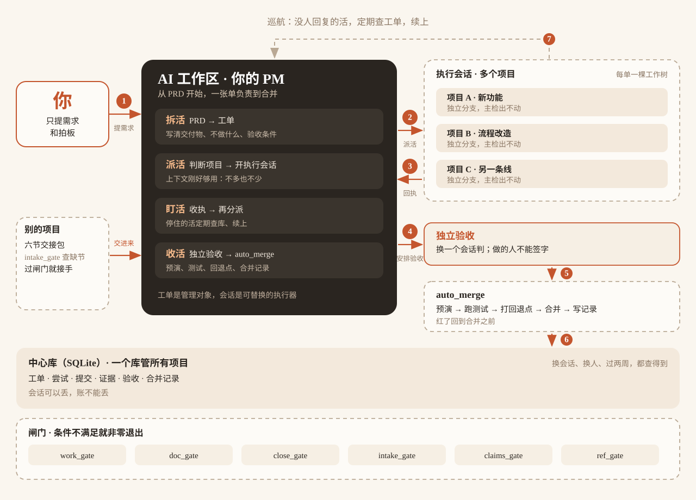
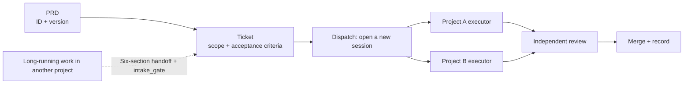

# AI Workspace Kit

中文版：[README.md](README.md)

**You talk to one PM. It breaks work into tickets, hands them to the right project, watches the receipts, keeps review separate from execution, merges after QA, and chases whatever nobody answered.**



[Where you are now](#where-you-are-now) · [What you are missing](#what-you-are-missing-is-a-pm) · [What the PM does](#what-the-pm-does-for-you) · [Six situations](#what-you-can-use-it-for-six-situations) · [Mechanism](#the-life-of-one-ticket) · [Run it once](#run-it-once-after-installing) · [Install](#install)

The workflow has run dozens of tickets in a real project. Everything specific to that project has been stripped out, and what remains is packaged here. You need Python 3.10 and an agent that reads `AGENTS.md`. Cindy, Claude Code and Codex all work.

---

## Where you are now

You have several projects and a dozen sessions open. The titles look alike, and yesterday's "rewrite the dispatch logic" is in one of them; you open three before you find it.

One session stops halfway and asks whether it should support Windows. You are in a meeting and do not answer. Two days later it is still sitting there, and its context has gone cold.

You have one session reworking the front end and another reworking the API. Both touch the same file. The merge conflicts, you fix it by hand, and you still do not know whether the tests ran.

You ask "is it done?" and it says "done". You open the diff and one of the three files was never touched. You cannot check every time, so "it said done" slowly becomes "done".

You want to push something forward from your phone, and the first step is remembering which project and which session it lives in.

You want to start a fourth piece of work, but the first three already have all of your attention.

None of this happens because the model is weak. Taken one at a time, the model can do all of it. It happens because every session's routing, memory, chasing and checking is pressed onto one person, and you only have one share of attention.

---

## What you are missing is a PM

Sort those problems and only four jobs remain:

- decide which project a piece of work belongs to, and who should do it;
- remember where each piece stands and whose turn is next;
- push when something has stopped and is waiting on you;
- check the delivery before it counts as delivered.

Those four jobs have a name: project manager. A PM takes requirements, breaks them down, hands them out, follows up, reviews, and reports. That is the whole job description.

You never had one because an agent's unit of work is a session. A session is an execution unit, not a management unit. It runs, it stops, it waits for you, but it does not know what the other sessions are doing, and it is not accountable to your project.

What this kit adds is not a stronger agent. It adds a **project layer**: the ticket becomes the object being managed, and the session drops back to being a replaceable executor. That layer is what makes a stable PM possible.

---

## What the PM does for you

### Breaking work down

A requirement becomes a ticket before anything runs. The ticket states what is being delivered, what is explicitly out of scope, and what the acceptance criteria are. If the criteria cannot be written down, the work is not thought through, and it does not start.

Each ticket is pinned to a PRD with an ID and a version. Change the PRD and the hash no longer matches, the old result is void, and the ticket has to be revised explicitly.

### Handing it out

The PM works out which project the ticket belongs to, dispatches it to that project's workspace, and opens a new executor session. You do not go hunting through a session list. One ticket runs per project by default; parallel work takes an explicit `allow_parallel`, so two tickets cannot quietly step on each other.

Handing work out is not mainly about finding a session. It is about writing down what is being handed out. Every ticket leaves with exactly the context it needs:

- **Not too much.** An executor receives this ticket and the one PRD it cites. It does not see other projects, and unrelated history does not pull it off course. Knowing more is not an advantage here; it leads to overreach and to edits nobody asked for.
- **Not too little.** The ticket has to be self-contained enough that a different session, or a different person, can start immediately. That is why deliverables and exclusions are mandatory, and why handoffs require six sections: the user's own words, what was tried and why it failed, hard constraints, confirmed facts, and open questions.

This is the handover a nurse gives at shift change. Only what matters: the patient's state, what was done, what comes next. Never omitting an allergy. More is noise, less is an incident.

Once the context is bounded, the executor becomes replaceable. A new session, a new person, a week later: same ticket, same work.

### Keeping it moving

When an executor submits, the receipt lands in the database and the PM decides the next hop. Decisions that need a human go through `ask_ticket` and are recorded, rather than a card that blocks the whole round. While you are busy, the work waits in the database; pair it with a host-side scheduled job and the PM can check ticket state on a timer and push stalled work forward again.

Review is done by a different session. It reads the ticket and the evidence, not the chat that produced them, so the judgement stays clean. The person who did the work cannot sign it off, and there is no switch for that.

### Bringing it home

Branches are planned before work starts: one ticket, one worktree, one `ticket/<id>` branch, with the main checkout staying on the main branch. Passing QA does not put anything on the main branch. Merging goes through `auto_merge.py`, which checks ticket state and branch, previews conflicts, tags a rollback point, and runs the tests in a temporary worktree. Only then does it merge with `--no-ff`, run the tests again, and write the merge record. If something fails, the branch returns to where it was before the merge.

A round does not end with "it is done" either. It ends with a seven-section closing packet, and `close_gate.py` decides whether the sections are there and which of three conclusions the round reached.

---

## Other projects can hand work in

When you are working in some other project and hit a task that is multi-step, deliverable and too large for one round, you do not have to grind through it alone. Hand it to this workspace. The handoff follows a fixed protocol: write a six-section packet, run `intake_gate.py` to catch missing sections, then send a four-line message that opens a new workspace session. The original session stops and afterwards only relays the receipt.

Everything needed for that path ships in the kit:

| Piece | Installed at | What it does |
| --- | --- | --- |
| `handoff-to-workspace` skill | `~/.agents/skills/handoff-to-workspace/` | Tells the agent when to hand work over, to whom, and in what four steps |
| Handoff protocol | `~/.agents/intake/intake.md` | Message template, six-section structure and checks, where the packet goes |
| `intake_gate.py` | `<workspace>/tools/intake_gate.py` | Exits non-zero on a missing section, so refusal is not a matter of good will |
| Project routing and dispatch rules | `AGENTS.md` plus the `project-routing` and `ticket-dispatch` skills | Ownership is never guessed; dispatch means opening a new session |



---

## What you can use it for: six situations

| What you are doing | What you end up with |
| --- | --- |
| Taking a feature from requirement to production | Criteria come from a versioned PRD, the plan passes a gate, doer and reviewer are separate, tests run before merge, and the database keeps the record |
| Pushing several projects at once | One central database shows every project's ticket state, without digging through separate chats |
| Receiving long-running work from another project | A six-section packet passes the gate and the task lands here; the original session stops and only relays the receipt |
| Changing a requirement mid-flight | The PRD hash no longer matches the ticket, submission is blocked by `STALE_PRD`, and the ticket has to be revised explicitly |
| Feeling unsure before a merge | `auto_merge` previews conflicts, runs tests, tags a rollback point, and returns to it when something fails |
| Coming back the next day | State lives in the database, so a new session or a new person can see where it stopped and whose turn it is |

---

## The life of one ticket

Those capabilities reduce to seven steps. Every step writes to the database, and a step that fails exits non-zero.

**Step 1, open the ticket.** `create_ticket` requires a deliverable (a topic, plus an explicit statement of what is out of scope), acceptance criteria, and the PRD version it is pinned to.

**Step 2, dispatch.** After `claim_ticket`, the coordinating session may not write the result itself. It opens a new session and hands the work over; binding with its own identifier is rejected as `SELF_DISPATCH`.

**Step 3, execute.** One ticket gets one git worktree and one `ticket/<id>` branch. The executor works in `.worktrees/<id>/` and leaves the main checkout alone.

**Step 4, submit.** `submit_result` carries the artifacts, a sha256 for each file, and the evidence. The ticket moves to `awaiting_review` and the executor stops.

**Step 5, independent review.** A different session reads the ticket and the evidence, then calls `review_result` with `accept` or `rework`.

**Step 6, merge.** The merge goes through `auto_merge.py`, which checks state, previews, tags a rollback point and runs the tests before it merges.

**Step 7, close the round.** Write the seven-section closing packet from `docs/closing.md`, and let `close_gate.py` judge it.

Throughout, the ticket state follows `ready → dispatching → running → awaiting_review → done`. Two side branches exist. When a human decision is needed, `ask_ticket` records the question and waits. When work goes back, the ticket returns to `rework` and is claimed again.

---

## Why you can trust it

Rules in a document go unread, so the real constraints sit in exit codes. These checks are not reminders; they are the default path that makes an operation fail:

| Check | What it blocks | When it runs |
| --- | --- | --- |
| `work_gate.py` | Committing without a ticket, a ticket from another repo, an attempt that is unbound or already finished | git commit hook, on every commit |
| `doc_gate.py` | A plan with no PRD basis, missing sections, or completion evidence a machine cannot judge | Before the work starts |
| `close_gate.py` | A closing packet with missing sections, an unchanged status line, or claimed in-flight work that does not exist | Before saying the round is over |
| `intake_gate.py` | A handoff packet with missing sections, about to be passed on | At handoff time |
| `claims_gate.py` | Numbers a document states that do not match their source: counts, sums, ratios, digests, sizes, line anchors, list lengths | When writing closing material or acceptance evidence |
| `ref_gate.py` | Citations pointing at a file, line or heading that does not exist | When one document cites another |
| `run_tests.py` | A change that leaves the test suite red | Before committing and merging |
| `auto_merge.py` | Manual merging, merging without tests, forcing a merge with conflicts | At merge time |

`auto_merge.py` has one easily missed rule. A merge commit is the only commit allowed without a ticket, because the merge happens after review, when the ticket is already `done`. Every other commit is held to the same rule.

---

## Why the rules look like this

Every rule traces back to a specific failure. These three are typical, and they are described as what happened.

**Once, a dispatch message carried a session identifier that was perfectly well formed. The database accepted it, and no session with that ID existed.** The string had been assembled from a temporary directory name. The record looked like a completed dispatch and pointed at nothing. Now the executor calls `get_current_session_id` itself, and the coordinator looks up the title and path with `list_sessions` before dispatching; if the lookup fails, nothing is bound and nothing is submitted.

**Another time, an executor submitted four artifacts and every sha256 was wrong.** The paths had no worktree prefix, so the database resolved them against the project root and hashed the files of the same name in the main checkout. The numbers were correct; the file they pointed at was not. Artifact paths now have to carry the `.worktrees/<id>/` prefix, and review checks them one by one.

**And once, a coordinator skipped ticketing and dispatch, did the work itself, then declared it complete.** The record looked thorough, but nobody else had looked at it. `SELF_DISPATCH` now rejects that binding on the spot, so the separation of doer and reviewer is a mechanism rather than an agreement.

---

## When to use it, and when not to

It is heavy. Opening a ticket means creating, claiming, binding, submitting and reviewing. Plans go through `doc_gate`, commits carry a ticket ID, and closing a round goes through `close_gate`. One ticket runs at a time by default, and parallel work takes an explicit `allow_parallel`. When no human is around to decide, the work waits in the database.

So it earns its cost on work that has to be delivered, reviewed by someone else, and picked back up days later: a new feature, a process change, or a document other people will follow.

For one-off chores, trying an idea, or running a throwaway script, just ask. Wrapping that in the workspace is self-inflicted pain.

A simple test: will anyone in two months ask how this was decided, who reviewed it, and on what grounds it was merged? If yes, use the workspace. If not, you do not need it.

---

## How it relates to orchestration modes and subagents

An orchestration mode (a Lead session with several Workers) turns "one task, one agent" into several. Each Worker is a full independent task with its own worktree and conversation history. They run in parallel, and they can be placed on another machine signed in to the same account. A subagent is lighter: a one-shot dispatch inside the same process.

Both answer the question of who is running and how work is handed out. The workspace answers a different set of questions: should this be done now, what counts as finished, who may change files, who reviews the result, and how does it get onto the main branch.

The differences show up in concrete places. In an orchestration mode, the Lead saying it is done is the end of it, and nothing can check whether that is true. In the workspace, an executor submits and then waits for another session's verdict. A Worker's worktree prevents file collisions and does not decide how the branch merges; the workspace merges through previews, tests and a rollback point. Orchestration state lives with the session and ends when the session is archived; workspace state lives in SQLite and outlives it.

The layers stack. Use orchestration to push several threads in parallel, and let each thread follow the workspace workflow inside its own project. The default dispatch carrier is an ordinary project session rather than a Worker, because an executor has to be openable for follow-up questions and has to submit results itself. A Worker is managed by a team, and once the team is archived it is gone.

The largest gap in the workspace sits right here. "Open an executor session after `claim_ticket`" needs a host capability; in Cindy that is `send_to_session`, and other hosts either add it or open a session by hand and call `bind_session`. This is listed under "known not implemented" in `AGENTS.md`, and it is not pretending otherwise.

---

## Install

Requirements: **Python 3.10+**, and **Git** is recommended. Without Git you lose the "no ticket, no commit" default path, and everything else still works.

```bash
git clone https://github.com/cazevfung/ai-workspace-kit ai-workspace-kit
cd ai-workspace-kit
python install.py
```

The default target is `~/ai-workspace`, and the skills go to `~/.agents/skills`. Skills that already exist are skipped by default, so your own configuration is not overwritten. Common options:

```bash
python install.py --workspace D:/ai-ws        # choose the workspace directory
python install.py --dry-run                   # print the plan, write nothing
python install.py --overwrite-skills          # replace same-named skills with the kit version
python install.py --no-skills                 # install the workspace only
python install.py --link-agents               # also link skills for ~/.claude and ~/.codex
```

Wrapper scripts are available too:

```bash
powershell -ExecutionPolicy Bypass -File scripts/install.ps1   # Windows
bash scripts/install.sh                                        # macOS / Linux
```

The installer does six things. It copies the workspace skeleton, installs the skills, writes `~/.agents/center.json` and the handoff protocol, initialises the central database and registers the project. Then it runs `git init` and makes the first commit, enables the hooks only after that commit, and turns on the commit gate. Run the three commands it prints when it finishes.

### Verify after installing

```bash
cd ~/ai-workspace
python tools/work_gate.py --list     # the first command of any round
python tools/run_tests.py            # should be green end to end
python tools/doc_gate.py --all       # should exit 0
```

The number of tests is whatever `run_tests.py` reports in its summary line, and it changes between tags. `v0.3.0` installs 453 of them.

### Run it once after installing

`examples/demo.py` walks the whole loop in a temporary database: create a ticket, dispatch, submit, review. It connects to no real session, writes nothing into your workspace, and deletes the temporary database when it ends.

```bash
cd ~/ai-workspace
PYTHONPATH=. python examples/demo.py            # macOS / Linux
$env:PYTHONPATH="."; python examples/demo.py    # Windows PowerShell
```

The output is the real receipt for every step. The review part is worth a look: the first submission carries one item and comes back as rework, and only the second one passes.

```text
{"operation": "review_result", "result": {"state": "rework", "reason": "只有一项，需要返工", ...}}
{"operation": "review_result", "result": {"state": "done", "reason": "满足两项要求", ...}}
```

That is an excerpt; the full output is one JSON object per line, ending with a line that says, in Chinese, one rejection, one rework, one pass.

---

## What gets installed

```
ai-workspace/
├── AGENTS.md              # behaviour contract: six hard rules, message channels, closing, branching
├── README.md
├── PRD/                   # requirements; every result must name a PRD and a version
├── tasks/                 # round.md (this round's goal), rounds.md (history), plan-*.md
├── task_center/           # ticket core (standard library only, SQLite)
├── tools/                 # gates, auto_merge, run_tests, session checks
├── tests/                 # cases for the ticket core and the gates
├── docs/                  # protocol / closing / probe / intake / skill-loading / claims-format
├── examples/
├── .agents/skills/        # workspace skills
└── .githooks/             # commit hooks
```

The skills are also installed to `~/.agents/skills`, so an agent can read them in **any** project. Count the directories there to see how many you have; `v0.3.0` installs 25.

- **Workspace skills (5):** `prd-authoring`, `pdsa-workflow`, `ticket-dispatch`, `plan-gate`, `skill-routing`
- **General skills (20):** `brainstorming`, `writing-plans`, `executing-plans`, `test-driven-development`,
  `systematic-debugging`, `verification-before-completion`, `code-review-and-quality`,
  `requesting-code-review`, `receiving-code-review`, `merge-latest-branches`, `writing-skills`,
  `shuo-ren-hua`, `dispatching-parallel-agents`, `subagent-driven-development`,
  `resumable-implementation-contracts`, `using-git-worktrees`, `doubt-driven-development`,
  `planning-and-task-breakdown`, `project-routing`, `handoff-to-workspace`

The first workspace skill worth reading is `skill-routing`. It assigns each decision point to a skill or to a fixed action, and `scripts/check_routing.py` fails on the spot when an assignment is missing or points at a skill that does not exist.

---

## Three ways to distribute it, and why the repo wins

| Approach | Who it suits | Can it install everything? | Verdict |
| --- | --- | --- | --- |
| **GitHub repo + `install.py`** | Everyone | Yes: code, gates, hooks and skills in one go | **Main channel** |
| **Skill package (SkillHub)** | People who just want a taste | No: a skill is instructions, it cannot install Python modules or hooks | Front door that points here |
| **Cindy plugin** | Cindy users only | No: plugins run in a sandbox and cannot touch home directories or git hooks | Optional wrapper, not the main channel |

The full analysis is in [`docs/SHARING.md`](docs/SHARING.md). In one sentence: half of this system's value lives on the filesystem, in worktrees, commit hooks and a local database, and neither plugins nor skills can reach that half. The repository is the only carrier that installs all of it, and the other two are thin front doors.

---

## Uninstall

```bash
python uninstall.py --workspace ~/ai-workspace          # remove the workspace (asks first)
python uninstall.py --skills                            # remove only this kit's skills
```

`~/.agents/center.json` and `~/.agents/intake/` are kept by default, since other projects may use them. Add `--all` to remove those too. The `.data/` directory inside the workspace holds your progress and is kept by default.

---

## Maintainers: syncing updates from upstream

`kit/`, `skills/` and `design/` come from an upstream workspace. After it changes, rebuild in three steps rather than copying files by hand:

```bash
python maintainer/sync_from_origin.py        # 1. sync, turning absolute paths into {{WORKSPACE}}
python maintainer/redact_for_public.py       # 2. strip usernames, session IDs and upstream business names
python verify/verify_install.py              # 3. install into a temp dir; all 14 checks must pass
```

Step 2 is not optional. `kit/tests/fixtures` is copied **verbatim** on purpose, because the absolute paths inside it are part of what the tests assert. The sync therefore brings real usernames and session IDs with it. `redact_for_public.py --check` runs the same scan alone before publishing.

`README`, `install.py`, `uninstall.py`, `kit/AGENTS.md`, `kit/PRD/` and `docs/*.md` are maintained by hand and are not overwritten by the sync. When upstream rules change, align them manually. Bump `VERSION` and update `CHANGELOG.md` on release.

---

## Provenance and license

The framework code, gates, skills and documents come from a personal AI workspace that has been running in production. Project-specific content and absolute local paths were removed when it was packaged. The design history, including the original PRDs and the AGENTS record, lives in `design/` for anyone who wants to understand why the rules look the way they do.

MIT License. See [`LICENSE`](LICENSE).
