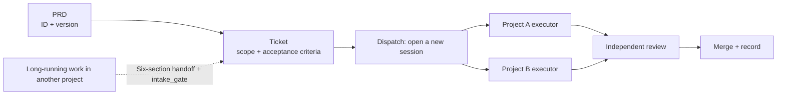

# AI Workspace Kit

中文版：[README.md](README.md)

This kit serves one purpose: when an AI says it is done, you can tell on the spot whether it really is.

It has three parts. A local database records tickets and reviews; it uses nothing but the standard library and SQLite, and lives in `task_center/`. A set of scripts in `tools/` check the work and exit non-zero when something is missing. The rules and skills in `AGENTS.md` and `skills/` are written for the agent to read.

The workflow has run dozens of tickets in a real project. Everything specific to that project has been stripped out, and what remains is packaged here. You need Python 3.10 and an agent that reads `AGENTS.md`. Cindy, Claude Code and Codex all work.

---

## What problem it solves

You let an AI take ten steps in a row, and at the end it says "done". That sentence leaves three questions unanswered. What was actually supposed to be delivered? Which project does this belong to? And on what grounds is it done?

The code is usually there. What is missing is a record other people can check. The next day you open a new session, or a colleague picks the work up two weeks later, and tries to work out why it was changed this way, who reviewed it, and why it was merged. Your only source is the chat log, and chat logs scroll away. A database does not.

This workspace puts all three things into one local SQLite file:

- a ticket holds the scope and the acceptance criteria;
- an attempt records which session is doing the work and which worktree it is bound to;
- a submission records the files, their sha256, and the evidence;
- a review records the verdict, the reasoning, and who gave it.

Sessions can be thrown away. The database cannot. That is the most basic design decision here.

So there are two layers. One is the process: how a requirement comes in, who does the work, who reviews it, how it lands on the main branch. The other is the decision points: which steps refuse to be vague, and fail on the spot when they are. The rest of this document covers the process first, then the decision points.

---

## From requirement to merge: it covers the whole line

A single ticket is only the smallest unit. The part that matters is the line: a requirement enters as a PRD, passes one review, gets dispatched to the right project, is reviewed by someone else when it comes back, and leaves a record when it merges. People change, sessions change, projects change, and the line still connects.

This is also where it differs most from "writing better prompts". A prompt governs how good this one answer is. This kit governs whether, ten steps later, you can still find out who did each step and what it passed on.

**A requirement starts as a PRD.** Each project has one, with an ID and a version. A ticket's "basis" section has to name the version it uses, and its acceptance criteria come from the PRD rather than being invented during execution. If the PRD changes and the ticket does not, the submission is blocked with `STALE_PRD` and the old result is void. The point of that rule is simple: when the requirement moves, someone has to revise the ticket explicitly, and results cannot quietly drift away from it.

**There are two reviews.** The first happens before any code. The PRD goes through the checklist in the `prd-authoring` skill, and the plan goes through `doc_gate`. `doc_gate` checks three things: whether the plan cites the PRD, whether it states what is being delivered and what is out of scope, and whether the completion evidence can be judged by a machine. The second review happens after delivery, when a different session gives the verdict. The person who did the work cannot sign it off.

**Tickets can be dispatched to different projects.** One central database covers every project. Each project registers a root directory, each ticket belongs to one project, and results stay in that project's repository. Once the coordinating session claims a ticket, it dispatches execution to that project's workspace, and review happens there too. Project ownership is never guessed. `probe` only offers candidates, and a human confirms the choice.

**Other projects can ask this workspace to take work over.** A session in any project that hits something multi-step, deliverable and too large for one round can hand it over instead of grinding through it alone. Handoffs follow a fixed protocol. First write a six-section handoff packet: the user's own words, what is to be delivered, what was tried before and why it failed, hard constraints, confirmed facts, and open questions. Run `intake_gate.py` to catch missing sections, then send a four-line message that opens a new workspace session.

Everything needed for that path ships in the kit:

| Piece | Installed at | What it does |
| --- | --- | --- |
| `handoff-to-workspace` skill | `~/.agents/skills/handoff-to-workspace/` | Tells the agent when to hand work over, to whom, and in what four steps |
| Handoff protocol | `~/.agents/intake/intake.md` | Message template, six-section structure and checks, where the packet goes |
| `intake_gate.py` | `<workspace>/tools/intake_gate.py` | Exits non-zero on a missing section, so refusal is not a matter of good will |
| Project routing and dispatch rules | `AGENTS.md` plus the `project-routing` and `ticket-dispatch` skills | Ownership is never guessed; dispatch means opening a new session |



After handing work over, the original session stops and only relays the receipt. On the receiving side, the first thing the coordinator does with a handoff packet is run the gate, not start reading the PRD.

What this arrangement buys you:

- **Requirements cannot drift quietly.** The PRD has a version and the ticket is pinned to it. When the requirement changes, the old result is void and a ticket revision is required.
- **The doer and the judge are separate.** An executor cannot accept its own work, a coordinator cannot write the result itself, and merging is backed by its own script.
- **Several projects share one ledger.** A single database answers what each project is working on, where it is stuck, and who is on it, without digging through separate chat logs.
- **The outside can hand work in.** Another project can pass a long-running task over with a six-section packet, without manually rebuilding context and without losing "what did not work last time".

---

## The life of one ticket

The path below is the whole mechanism. Every step writes to the database, and a step that fails exits non-zero.

**Step 1, open a ticket.** `create_ticket` requires a deliverable, with a topic and an explicit statement of what is out of scope, plus acceptance criteria. If you cannot write the acceptance criteria, the work is not thought through yet, and that is worth fixing first.

**Step 2, dispatch.** After `claim_ticket`, the coordinating session may not write the result itself. It has to open a new session, hand the work over, and binding with its own identifier is rejected as `SELF_DISPATCH`. The rule exists because dispatching to yourself is far too easy in other workflows.

**Step 3, execute.** One ticket gets one git worktree and one `ticket/<id>` branch. The executor works in `.worktrees/<id>/`, while the main checkout stays on the main branch, so a merge cannot accidentally run in the wrong direction.

**Step 4, submit.** `submit_result` carries the artifacts, a sha256 for each file, and the evidence. After that the ticket moves to `awaiting_review` and the executor stops.

**Step 5, independent review.** A different session reads the ticket and the evidence, then calls `review_result` with a verdict: `accept` or `rework`. The person who did the work does not get to review it, and there is no switch to turn that off.

**Step 6, merge.** Passing review does not put anything on the main branch. Merging goes through `tools/auto_merge.py`, which first checks four things: the ticket is `done`, there is no merge record yet, the checkout is clean, and the source branch is genuinely ahead. Once those pass, it previews conflicts, tags a rollback point, and runs the tests in a temporary worktree. If they pass it merges with `--no-ff`, runs the tests again, and only then writes the merge record. If anything fails, it returns to the rollback point and the main branch never moved.

**Step 7, close the round.** A round does not end with the words "it is done". Write the seven-section closing packet described in `docs/closing.md`, then run `close_gate.py`. It checks that all seven sections are present and that section 3 is not a bare "none". The conclusion also has to be one of three values: closed, waiting on an answer, or needs a restart.

Throughout, the ticket state follows `ready → dispatching → running → awaiting_review → done`. Two side branches exist. When a human decision is needed, `ask_ticket` records the question and waits. When work goes back, the ticket returns to `rework` and is claimed again.

---

## Decision points that actually block

Rules in a document go unread, so the real constraints sit in exit codes. These checks are not reminders; they are the default path that makes an operation fail:

| Check | What it blocks | When it runs |
| --- | --- | --- |
| `work_gate.py` | Committing without a ticket, a ticket from another repo, an attempt that is unbound or already finished | git commit hook, on every commit |
| `doc_gate.py` | A plan with no PRD basis, missing sections, or completion evidence a machine cannot judge | Before the work starts |
| `close_gate.py` | A closing packet with missing sections, an unchanged status line, or claimed in-flight work that does not exist | Before saying the round is over |
| `intake_gate.py` | A handoff packet with missing sections, about to be passed on | At handoff time |
| `run_tests.py` | A change that leaves the test suite red | Before committing and merging |
| `auto_merge.py` | Manual merging, merging without tests, forcing a merge with conflicts | At merge time |

`auto_merge.py` has one easily missed rule. A merge commit is the only commit allowed without a ticket, because the merge happens after review, when the ticket is already `done`. Every other commit is held to the same rule.

---

## Why the rules look like this

Every rule traces back to a specific failure. None of them were designed on a whiteboard. These three are typical, and they are described as what happened rather than as case IDs.

**Once, a dispatch message carried a session identifier that was perfectly well formed. The database accepted it, and no session with that ID existed.** The string had been assembled from a temporary directory name. The record looked like a completed dispatch and pointed at nothing, which is harder to spot than an obvious placeholder. What the rules require now runs both ways. The executor calls `get_current_session_id` itself and writes down what it gets, without assembling or abbreviating it. Before dispatching, the coordinator looks up the title and path with `list_sessions` using the working directory, and if the lookup fails, nothing is bound and nothing is submitted.

**Another time, an executor submitted four artifacts and every sha256 was wrong.** The paths in the submission had no worktree prefix, so the database resolved them against the project root and hashed the files of the same name in the main checkout. The numbers were correct; the file they pointed at was not. Artifact paths now have to carry the `.worktrees/<id>/` prefix, and review checks them one by one.

**And once, a coordinator skipped ticketing and dispatch, did the work itself in the coordinating session, then declared it complete.** The record looked thorough, but nobody else had looked at it. `SELF_DISPATCH` now rejects that binding on the spot, so the separation of doer and reviewer is a mechanism rather than an agreement.

---

## When to use it, and when not to

It is heavy. Opening a ticket means creating, claiming, binding, submitting and reviewing. Plans go through `doc_gate`, commits carry a ticket ID, and closing a round goes through `close_gate`. By default only one ticket runs at a time, and `claim_ticket` reports `DISPATCH_BUSY` while another ticket in the same project is in flight. Running things in parallel takes an explicit `allow_parallel`. When no human is around to decide, the work waits in the database.

So it earns its cost on work that has to be delivered, reviewed by someone else, and picked back up days later: a new feature, a process change, or a document other people will follow.

For one-off chores, trying an idea, or running a throwaway script, just ask. Wrapping that in the workspace is self-inflicted pain.

A simple test: will anyone in two months ask how this was decided, who reviewed it, and on what grounds it was merged? If yes, use the workspace. If not, you do not need it.

---

## How it relates to orchestration modes and subagents

These three are often mixed up, but they answer different questions.

An orchestration mode (a Lead session with several Workers) turns "one task, one agent" into several. Each Worker is a full independent task with its own worktree and conversation history. They run in parallel, and they can be placed on another machine signed in to the same account. A subagent is lighter: a one-shot dispatch inside the same process, finished when it returns.

Both answer the question of who is running and how work is handed out. The workspace answers a different set of questions: should this be done now, what counts as finished, who may change files, who reviews the result, and how does it get onto the main branch.

The differences show up in concrete places. In an orchestration mode, the Lead saying it is done is the end of it, and nothing can check whether that is true. In the workspace, an executor submits and then waits for another session's verdict. A Worker's worktree prevents file collisions and does not decide how the branch merges; the workspace merges through previews, tests and a rollback point. Orchestration state lives with the session and ends when the session is archived; workspace state lives in SQLite and outlives it.

The layers stack. Use orchestration to push several threads in parallel, and let each thread follow the workspace workflow inside its own project. The default dispatch carrier is an ordinary project session rather than a Worker, because an executor has to be openable for follow-up questions and has to submit results itself. A Worker is managed by a team, and once the team is archived it is gone.

The largest gap in the workspace sits right here. "Open an executor session after `claim_ticket`" has no automated adapter yet; the coordinator calls `send_to_session` by hand. This is listed under "known not implemented" in `AGENTS.md`, and it is not pretending otherwise.

---

## Install

Requirements: **Python 3.10+**, and **Git** is recommended. Without Git you lose the "no ticket, no commit" default path, and everything else still works.

```bash
git clone https://github.com/cazevfung/ai-workspace-kit ai-workspace-kit
cd ai-workspace-kit
python install.py
```

The default target is `~/ai-workspace`, and the skills go to `~/.agents/skills`. Skills that already exist are skipped by default, so your own configuration is not overwritten. Common options:

```bash
python install.py --workspace D:/ai-ws        # choose the workspace directory
python install.py --dry-run                   # print the plan, write nothing
python install.py --overwrite-skills          # replace same-named skills with the kit version
python install.py --no-skills                 # install the workspace only
python install.py --link-agents               # also link skills for ~/.claude and ~/.codex
```

Wrapper scripts are available too:

```bash
powershell -ExecutionPolicy Bypass -File scripts/install.ps1   # Windows
bash scripts/install.sh                                        # macOS / Linux
```

The installer does six things. It copies the workspace skeleton, installs the skills, writes `~/.agents/center.json` and the handoff protocol, initialises the central database and registers the project. Then it runs `git init` and makes the first commit, enables the hooks only after that commit, and turns on the commit gate. Run the three commands it prints when it finishes.

### Verify after installing

```bash
cd ~/ai-workspace
python tools/work_gate.py --list     # the first command of any round
python tools/run_tests.py            # should be green end to end
python tools/doc_gate.py --all       # should exit 0
```

The number of tests is whatever `run_tests.py` reports in its summary line, and it changes between tags. `v0.2.1` installs 381 of them.

---

## What gets installed

```
ai-workspace/
├── AGENTS.md              # behaviour contract: six hard rules, message channels, closing, branching
├── README.md
├── PRD/                   # requirements; every result must name a PRD and a version
├── tasks/                 # round.md (this round's goal), rounds.md (history), plan-*.md
├── task_center/           # ticket core (standard library only, SQLite)
├── tools/                 # gates, auto_merge, run_tests, session checks
├── tests/                 # cases for the ticket core and the gates
├── docs/                  # protocol / closing / probe / intake / skill-loading
├── examples/
├── .agents/skills/        # workspace skills
└── .githooks/             # commit hooks
```

The skills are also installed to `~/.agents/skills`, so an agent can read them in **any** project. Count the directories there to see how many you have; `v0.2.1` installs 25.

- **Workspace skills (5):** `prd-authoring`, `pdsa-workflow`, `ticket-dispatch`, `plan-gate`, `skill-routing`
- **General skills (20):** `brainstorming`, `writing-plans`, `executing-plans`, `test-driven-development`,
  `systematic-debugging`, `verification-before-completion`, `code-review-and-quality`,
  `requesting-code-review`, `receiving-code-review`, `merge-latest-branches`, `writing-skills`,
  `shuo-ren-hua`, `dispatching-parallel-agents`, `subagent-driven-development`,
  `resumable-implementation-contracts`, `using-git-worktrees`, `doubt-driven-development`,
  `planning-and-task-breakdown`, `project-routing`, `handoff-to-workspace`

The first workspace skill worth reading is `skill-routing`. It assigns each decision point to a skill or to a fixed action, and `scripts/check_routing.py` fails on the spot when an assignment is missing or points at a skill that does not exist.

---

## Three ways to distribute it, and why the repo wins

| Approach | Who it suits | Can it install everything? | Verdict |
| --- | --- | --- | --- |
| **GitHub repo + `install.py`** | Everyone | Yes: code, gates, hooks and skills in one go | **Main channel** |
| **Skill package (SkillHub)** | People who just want a taste | No: a skill is instructions, it cannot install Python modules or hooks | Front door that points here |
| **Cindy plugin** | Cindy users only | No: plugins run in a sandbox and cannot touch home directories or git hooks | Optional wrapper, not the main channel |

The full analysis is in [`docs/SHARING.md`](docs/SHARING.md). In one sentence: half of this system's value lives on the filesystem, in worktrees, commit hooks and a local database, and neither plugins nor skills can reach that half. The repository is the only carrier that installs all of it, and the other two are thin front doors.

---

## Uninstall

```bash
python uninstall.py --workspace ~/ai-workspace          # remove the workspace (asks first)
python uninstall.py --skills                            # remove only this kit's skills
```

`~/.agents/center.json` and `~/.agents/intake/` are kept by default, since other projects may use them. Add `--all` to remove those too. The `.data/` directory inside the workspace holds your progress and is kept by default.

---

## Maintainers: syncing updates from upstream

`kit/`, `skills/` and `design/` come from an upstream workspace. After it changes, rebuild in three steps rather than copying files by hand:

```bash
python maintainer/sync_from_origin.py        # 1. sync, turning absolute paths into {{WORKSPACE}}
python maintainer/redact_for_public.py       # 2. strip usernames and session IDs the sync carried in
python verify/verify_install.py              # 3. install into a temp dir; all 14 checks must pass
```

Step 2 is not optional. `kit/tests/fixtures` is copied **verbatim** on purpose, because the absolute paths inside it are part of what the tests assert. The sync therefore brings real usernames and session IDs with it. `redact_for_public.py --check` runs the same scan alone before publishing.

`README`, `install.py`, `uninstall.py`, `kit/AGENTS.md`, `kit/PRD/` and `docs/*.md` are maintained by hand and are not overwritten by the sync. When upstream rules change, align them manually. Bump `VERSION` and update `CHANGELOG.md` on release.

---

## Provenance and license

The framework code, gates, skills and documents come from a personal AI workspace that has been running in production. Project-specific content and absolute local paths were removed when it was packaged. The design history, including the original PRDs and the AGENTS record, lives in `design/` for anyone who wants to understand why the rules look the way they do.

MIT License. See [`LICENSE`](LICENSE).
