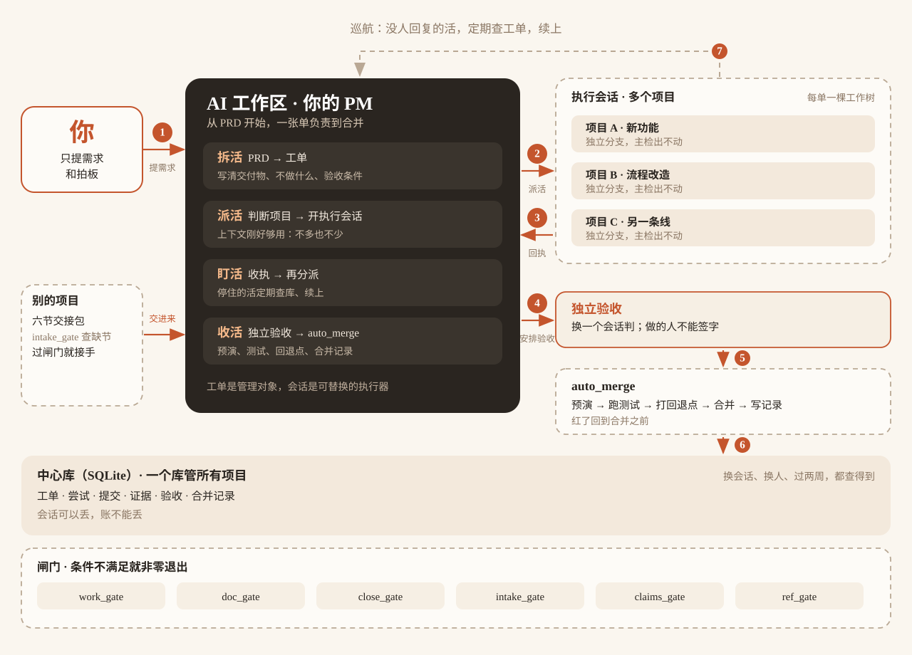
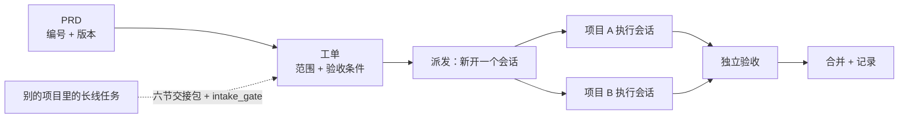

# AI 工作区套件（AI Workspace Kit）

English version: [README.en.md](README.en.md)

**这是一套装在本地的 AI 项目管理流程。你只向一个 PM 提需求：它把需求拆成工单、派到对应项目的新会话、盯着回执、安排另一个会话独立验收，验收与测试都通过之后才允许合并进主分支。**



[它解决什么问题](#它解决什么问题) · [它是什么](#它是什么) · [上下文边界](#上下文边界) · [一张单的一生](#一张单的一生) · [闸门与判定点](#闸门与判定点) · [已知限制](#已知限制) · [安装](#安装) · [验证与 demo](#验证与-demo)

这套流程在一个真实项目里跑过几十张工单，去掉项目专属内容之后打包成本套件，当前版本 0.4.0。运行需要 Python 3.10+，以及一个会读 `AGENTS.md` 的 agent 宿主；Cindy、Claude Code、Codex 均可。

---

## 它解决什么问题

命令行 agent 的单次执行能力通常不是瓶颈，瓶颈在于多个会话并行时缺少一层管理：进度、归属、验收与上下文全部压在用户一个人身上。具体是四类问题。

- **会话分散。** 几件事各自跑在不同项目的不同会话里，想知道某件事的进度，要先想起它在哪个项目、哪条会话，再逐个翻记录。
- **进度不可查。** 会话停下来等人答复时不留记录，隔两天再看，上下文已经凉了，只能从聊天里重建现场。
- **执行与验收不分。** 会话自己宣布完成，diff 里却缺文件；没有机制强制第二双眼睛核对，「它说完成」就逐渐等于「完成」。
- **上下文失控。** 两条并行会话改了同一批文件，合并冲突靠手工解。

这些问题的共同点不是模型不够强，而是没有一个对项目负责的管理层。本套件补的就是这一层。

---

## 它是什么

它扮演一个项目经理的角色，做四件事：拆活、派活、盯活、收活。实现上由四部分组成：`task_center/` 是工单核心（纯标准库 + SQLite），管项目、工单、提交、验收与合并记录；`tools/` 是闸门与合并脚本；`AGENTS.md` 是写给 agent 的行为契约；`skills/` 是 26 个技能，6 个工作区技能加 20 个通用技能。它不提升模型能力，它把「谁做、做到什么算完、谁验、凭什么合」变成可查询的记录和会失败的检查。

### 拆活

需求先落成工单才能开工：写清交付物（主题，以及明确不覆盖什么）与验收条件，绑定 PRD 路径与内容哈希。验收条件写不出来，说明需求还没想清楚，就先不开工。PRD 内容一改，哈希对不上，旧提交被 `STALE_PRD` 拒绝，必须显式 `revise_ticket`。

### 派活

工单按项目归属派到对应工作区，由一个新开的执行会话接手；协调会话拿自己的标识去绑定会被 `SELF_DISPATCH` 拒绝。同一项目默认一次只跑一张单，已有在途工单时 `claim_ticket` 报 `DISPATCH_BUSY`；确需并行，显式传 `allow_parallel`。

### 盯活

执行会话交回成果后，回执落进中心库，由协调侧决定下一环派给谁；需要人拍板的问题走 `ask_ticket` 落库等待，不阻塞其他工单。停住的活没有内置调度器：要配合宿主的定时任务定期查库，把该继续的工单重新派下去。

### 收活

验收由另一个会话完成，它只看工单与证据，不看执行时的聊天记录；执行者不能验收自己，这条没有开关。合并只能走 `auto_merge.py`：核对状态与分支、预演冲突、打回退点、临时工作树里跑测试、`--no-ff` 合并、合并后再测一次并写回记录，失败即回到回退点。一轮结束时还要交七节收尾包，由 `close_gate.py` 判定结论落在「已收尾 / 等一句答复 / 需重开一轮」的哪一档。

---

## 上下文边界

每张工单交出去时带着刚好够用的上下文：不多给，不少给，版本可查，执行单元因此可替换。

- **不多给。** 执行会话只拿到这张单和它引用的那份 PRD，看不到其他项目，也不被无关历史带偏。
- **不少给。** 交付物、不做什么、验收条件、PRD 版本与哈希、证据要求都是必填项；跨会话交接另要求六节交接包：用户原话、要交付什么、上次为什么不行、硬约束、已确认事实、未决问题。
- **可替换。** 单子自包含，换会话、换人、隔一周再来都能直接开工。

这个边界像护士交班：只交关键信息，但不许漏掉过敏史。多交是噪音，少交是事故。

---

## 跨项目派单与外部交接

中心库一张表管所有项目，每个项目登记一个根目录，一张工单只属于一个项目；项目归属不许猜，`probe` 只给候选，由人确认。别的项目里的长线任务可以按固定协议交进来；交完原会话停手，只向用户转述回执。交接链有四个件，装完即可用：

| 件 | 装到哪 | 作用 |
| --- | --- | --- |
| `handoff-to-workspace` 技能 | `~/.agents/skills/handoff-to-workspace/` | 告诉 agent 什么时候该交、交给谁、四步怎么做 |
| 交接协议正文 | `~/.agents/intake/intake.md` | 四行消息模板、六节结构与判据、落点选择 |
| `intake_gate.py` | `<工作区>/tools/intake_gate.py` | 缺节就非零退出，拒收不是靠自觉 |
| 项目定位与派发规则 | `AGENTS.md` 与 `project-routing`、`ticket-dispatch` 两个技能 | 项目归属不许猜；派发就是新开一个会话 |



---

## 六个典型场景

| 你在做什么 | 用完之后会怎样 |
| --- | --- |
| 一个新功能从需求做到上线 | 需求带 PRD 版本，计划过闸门，执行与验收分开，合并前跑测试，库里留着完整记录 |
| 同时推进几个项目 | 一个中心库看所有项目的工单状态，不用翻各自的聊天记录 |
| 别的项目交来一件长线活 | 六节交接包过闸门，任务落进工作区；原会话停手，只向用户转述回执 |
| 需求中途改了 | 工单绑的 PRD 哈希对不上，提交被 `STALE_PRD` 挡住，必须显式修订 |
| 合并前对风险没把握 | `auto_merge` 预演冲突、跑测试、打回退点，测试失败时自动回到合并之前 |
| 隔天回来接着做 | 状态在库里，换会话、换人都能查到卡在哪、下一步该谁 |

---

## 一张单的一生

上述能力落到一张工单上是七步，每步写库，失败即非零退出。

1. **开工单。** `create_ticket` 写清交付物与验收条件，绑定 PRD 路径与内容哈希。
2. **领取。** `claim_ticket` 由协调会话领取，生成 attempt，工单进入 `dispatching`。
3. **绑定。** 新开一个执行会话并 `bind_session`；拿协调会话自己的标识绑定会被 `SELF_DISPATCH` 拒绝。
4. **执行。** 一张工单对应一棵 git 工作树、一条 `ticket/<工单号>` 分支，主检出始终停在主分支。
5. **提交。** `submit_result` 带成果文件、每个文件的 sha256、证据与被验收那棵树的 `head_sha`，工单进入 `awaiting_review`。
6. **验收。** 另一个会话逐项判定，`review_result` 给出 `accept` 或 `rework`。
7. **合并与收尾。** `auto_merge.py` 完成合并，`close_gate.py` 判定七节收尾包。

整条路上工单状态都在 `ready → dispatching → running → awaiting_review → done` 这条链上，另有两条旁支：需要人拍板时走 `ask_ticket` 进入 `blocked`，验收不通过回到 `rework` 重新领取。

---

## 闸门与判定点

规则写在文档里通常没人读，约束放在退出码上：这些检查不是提醒，是默认让操作失败。

| 检查 | 它拦什么 | 什么时候跑 |
| --- | --- | --- |
| `work_gate.py` | 没有工单就想提交；工单不属于本仓库；尝试没绑定或已经结束 | git commit 钩子，每次提交 |
| `doc_gate.py` | 计划没读 PRD、没写依据、缺节、完成证据不可判定 | 写计划之后、开工之前 |
| `close_gate.py` | 收尾包缺节、状态位没改、说有在途单其实没有 | 说「这一轮结束」之前 |
| `intake_gate.py` | 交接包缺节就想把长线任务交进来 | 交接时 |
| `claims_gate.py` | 文档里写的数与源数据对不上：计数、合计、比例、摘要、字节数、行号锚点、清单条数 | 写结案材料与验收证据时 |
| `ref_gate.py` | 引用指向不存在的文件、行号或标题 | 文档之间互相引用时 |
| `run_tests.py` | 改完之后测试不全绿 | 提交前、合并前 |
| `auto_merge.py` | 手工合并、跳过测试直接合并、有冲突时强行合并 | 合并时 |
| `wait_audit.py` | 谁在等谁而没人知道：等在验收超 4 小时、**提交后 15 分钟还没有 `sent` 回执**、`done` 没回执、`done` 没合并、`running` 的单执行会话 10 分钟没活动 | 派完活之后的一次只读巡检 |
| `idle_watch.py` | 主任务里「我在等你一句话」而你不知道：末条是问句或提问卡、之后没人说话 | 想知道哪条会话悬着的时候 |
| `project_doctor.py` | 项目登记了、钩子却没装：`core.hooksPath` 不指向本仓库 `.githooks`、`.worktrees/` 没被忽略、根上没有 `AGENTS.md` | 接一个新项目之后 |

`auto_merge.py` 还有一条容易忽略的规矩：合并提交是「没有工单也能提交」的唯一例外，因为合并发生在验收之后，那一刻工单已经是 `done`。其它提交一字不放。

---

## 为什么规则长这样

每条规则都能追到一次具体的事故，下面三次比较典型，只讲当时发生了什么。

**有一次，派发消息里写了一个格式完全正确的会话标识，库照收了，但会话列表里根本没有这条。** 那个字符串是从临时目录名拼出来的，记录看上去像完成了一次派发，实际指向不到任何会话。现在执行会话自己调 `get_current_session_id` 取标识，协调会话派发前用 `list_sessions` 反查标题与路径，查不到就不许绑定，也不许提交。

**另一次，执行会话提交了四条成果文件，sha256 全对不上。** 因为路径没带工作树前缀，库按项目根解析，算的是主检出里同名文件的哈希。数字本身没有错，错的是它指向的文件。现在成果路径必须带 `.worktrees/<工单号>/` 前缀，验收时逐条核对。

**还有一次，协调会话跳过开单与派发，自己把成果做完，然后自己宣布完成。** 记录看起来完整，但没有第二双眼睛看过。现在 `SELF_DISPATCH` 会当场拒绝这种绑定，执行者与验收者的分离从约定变成了机制。

---

## 什么活该用它，什么活别用

它重，适合要交付、要能被复核、跨天跨会话还接得上的活；一次性小事直接处理，套用工单流程得不偿失。开一张单要走建单、领取、绑定、提交、验收五步，规划要过 `doc_gate`，提交要带工单号，收尾要过 `close_gate`。判据只有一个：这件事两个月后还有没有人会问「当时是怎么定的、谁验的、凭什么合进去的」。会问，就走工作区；不会，就不必。

---

## 与其他编排方式的关系

协同模式与 subagent 回答「谁在跑、活怎么派」，这套工作区回答「该不该做、做到什么算完、谁验收、怎么合进主分支」，两者不在一个层级，可以叠用。差别有三处：协同模式里 Lead 说做完就是做完，这里执行者提交之后必须等另一个会话给结论；协同模式的 worktree 只解决文件冲突，这里的合并有预演、测试与回退点；协同模式的状态随会话归档消失，这里的状态在 SQLite 里，会话没了记录还在。叠用方式是：协同模式并行推进，每一路在自己的项目里走工作区流程；默认派发载体是项目普通会话，不是 Worker。

---

## 已知限制

选用之前应当知道四条限制。

- 「`claim_ticket` 之后自动新建执行会话」依赖宿主能力：Cindy 里是 `send_to_session`，其他宿主需要自己补这一步，或手工开会话再 `bind_session`。
- 巡航不是内置调度器：仓库里没有定时任务，要把停住的工单续上，需要配合宿主的定时任务定期查库、重新派发。
- 默认一次一张单，并行要显式传 `allow_parallel`。
- 技能内容以中文为主，暂未翻译。

---

## 安装

要求 Python 3.10+；建议装 Git，没有也能用，只是少了「没工单不许提交」这道默认路径。

```bash
git clone https://github.com/cazevfung/ai-workspace-kit ai-workspace-kit
cd ai-workspace-kit
python install.py
```

默认装到 `~/ai-workspace`，并把技能装到 `~/.agents/skills`（同名技能默认跳过，不覆盖原有配置）。常用参数：

```bash
python install.py --workspace D:/ai-ws        # 指定工作区目录
python install.py --dry-run                   # 只打印计划，不动任何文件
python install.py --overwrite-skills          # 用套件版本覆盖同名技能
python install.py --no-skills                 # 只装工作区，不动技能目录
python install.py --link-agents               # 顺带为 ~/.claude 与 ~/.codex 建技能链接
```

也可以用包装脚本：`bash scripts/install.sh`（macOS / Linux）、`powershell -ExecutionPolicy Bypass -File scripts/install.ps1`（Windows）。

---

## 验证与 demo

装完跑三条命令确认：

```bash
cd ~/ai-workspace
python tools/work_gate.py --list     # 开工第一条命令
python tools/run_tests.py            # 应全部通过：tests/ 303 + tools/ 422 = 725 项，失败 0
python tools/doc_gate.py --all       # 应退出 0
```

装完还要把工作区接进宿主、把业务仓库接进工作区：

```bash
cd ~/ai-workspace
python onboard.py --json                       # create_project → 开会话 → 第一条指令，每步完整参数
python tools/add_project.py D:/my-project      # 业务仓库写 .agents/ticket-config.json 并指向 .githooks
```

### 接项目这一步：clone 之后先跑 `add_project.py`

每个要开工的业务仓库都得先接进来，一条命令：

```bash
cd ~/ai-workspace
python tools/add_project.py D:/my-project
```

它做两件事：写 `<仓库>/.agents/ticket-config.json`（`test_cmd` / `target_branch` / `test_timeout`，`project_id` 可选），并把那个仓库的 `core.hooksPath` 指向套件的 `.githooks`。写出来的文件长这样：

```json
{
  "version": 1,
  "project_id": "my-project",
  "target_branch": "master",
  "test_cmd": ["python", "tools/run_tests.py"],
  "test_timeout": 1800
}
```

**为什么这一步不能省**：`tools/auto_merge.py` 的第 2 步就是「项目配置」——缺 `.agents/ticket-config.json`、缺 `test_cmd` 或 `target_branch`，它就停在那一步并指向 `add_project.py`，不会回落到任何默认测试命令。不配等于没有测试，而「没跑测试」绝不能长得像「跑过了」。

用例数以 `run_tests.py` 的汇总行为准，每个 tag 会变；当前套件在隔离的用户级目录（`--agents-home`）下装出来是 725 项（`tests/` 303、`tools/` 422）。
这句话是在装出来的现场实测的，不是只在源码树里跑绿的：

```bash
# 临时工作区 + 隔离的用户级目录（--agents-home），不碰您自己的 ~/.agents
DRILL=/tmp/awk104-drill
python install.py --workspace "$DRILL/ws" --agents-home "$DRILL/home/.agents"
cd "$DRILL/ws" && python tools/run_tests.py      # 末行应写「结果：全部通过」，合计 725 项
python verify/verify_receipt.py --workspace .    # 装完 verify/ 就在工作区里，不用回源码树找
```

两种布局都要能跑：源码树里 `verify_receipt.py` 在仓库根（`install.py` 从那里复制），
装出来的工作区里它在 `<工作区>/verify/`。`tools/test_verify_receipt.py` 两处都认，
只装了一个跑不起来的壳就会当场报错，不会静静跳过。

#### 与工作区（`D:/AI工作区`）的已知差异

引擎已经同步到工作区当前的状态（中心库 schema 16）：迁移 9–16、发号（`projects.next_number`）、`planned` 与依赖边、车次（`batches`）、提交时的冲突预演、`criteria_version`、谁开的单（`tickets.requester_session_id`）与回执的消息 id（`notices.message_id`）、现在谁负责收尾（`tickets.owner_session_id`，配套 `take_over_ticket` / `report_notice_failure`）、合并记录的出处四列（`merges.source` / `verified_by` / `verified_at` / `note`）都跟工作区一致，`python kit/tools/auto_merge.py --list --db <共享库>` 读同一个库不再报 `SCHEMA_MISMATCH`。下面六条是**刻意留着的不一致**（其中前两条随 R-002 收敛了：PRD 正文与 `auto_merge` 的 schema 闸门现在都在套件里）：

1. **PRD 正文只同步了一部分。** 包里现在有 `kit/PRD/PRD-001-工作区使用与工单体系.md` 与 `PRD-010`~`PRD-015` 六份正文（路径与示例已改成套件视角，`grep -rl "D:/AI工作区" kit/PRD/` 为空）。`PRD-002`~`PRD-009` 是这套工具自己的设计史，正文在 `design/PRD/` 下，不进 `kit/PRD/`；引擎注释里出现这些编号时指的是那一份。与工作区仍有一处差别：`PRD-015` 里两条复算命令原来指向工作区的历史轮次表与收尾包，套件不带这些文件，所以那两处写成了「原工作区的第 N 行」而不是可点的 `文件:行号`——否则 `ref_gate` 会把它们当成断链。
2. **`auto_merge.py` 保留套件这一版，但 schema 闸门已经补齐。** 它读项目配置、缺配置就拒；写记录前那道闸门现在也在：代码要求更高就先做文件层快照、用合并后的代码 `migrate`、再把进程里那份 `task_center` 重载，失败就停在第 7 步并报 `SCHEMA_MIGRATE_FAILED`。与工作区唯一的差别是**它认两个位置**——`task_center/db.py` 与 `kit/task_center/db.py` 都算，因为套件的引擎住在 `kit/` 下，只按仓库根找会让闸门在这个仓库上永远静默跳过（AWK-101 就是这样把 schema 从 9 推到 13 而闸门没响）。
3. **占位符没有被换成固定路径。** `work_gate.py` / `close_gate.py` / `run_tests.py` / `intake_gate.py` 里的用法写的是 `{{WORKSPACE}}`，装的时候才替换成真实路径。
4. **`doc_gate.py` 多认两处源码树里的技能路径**（`skills/workspace`、`skills/generic`），所以在没装过的源码仓库里直接跑测试也是绿的。
5. **夹具已脱敏**：真实会话 id 换成 `<session-id>`，个人目录换成 `X:/示例项目`。
6. **`kit/docs/protocol.md` 只把「操作与字段」那张表补到了当前命令面（schema 16）**：`planned` 池子、依赖边、车次、`base_sha`、冲突预演、`requester_session_id` / `owner_session_id` / `merges` 出处四列都在表里。表下面那些节仍是原文，缺的是 PRD-005/013/014/015 的正文（派发载体、回信三档、合并断在半路等）；那几节与 `task_center/core.py` 的 `FIELDS` 不一致时以代码与 `kit/PRD/` 为准。

套件仓库里还有一条九步自检，它在临时 HOME 里真装一遍再走完闭环：

```bash
python verify/verify_onboard.py
```

`examples/demo.py` 用一个临时库把闭环走一遍：建工单、派发、提交、验收。它不连真实会话，不写你的工作区，结束时删掉临时库。

```bash
cd ~/ai-workspace
PYTHONPATH=. python examples/demo.py            # macOS / Linux
$env:PYTHONPATH="."; python examples/demo.py    # Windows PowerShell
```

输出是每一步的真实回执。验收那一段值得看：第一次提交只带了一项成果，被判返工；补到两项才通过。

```text
{"operation": "review_result", "result": {"state": "rework", "reason": "只有一项，需要返工", ...}}
{"operation": "review_result", "result": {"state": "done", "reason": "满足两项要求", ...}}
```

上面是摘录，完整输出是逐行 JSON，最后一行写着「一次拒收、一次返工、一次通过」。

---

## 装了什么

```text
ai-workspace/
├── AGENTS.md              # 行为契约：六条硬规则、消息通道、收尾、分支与合并
├── README.md
├── PRD/                   # 需求；每个成果都要报 PRD 编号与版本
├── tasks/                 # round.md（本轮目标）、rounds.md（历史）、plan-*.md
├── task_center/           # 工单核心（纯标准库，SQLite）
├── tools/                 # 闸门 + auto_merge + run_tests + 会话核对
├── tests/                 # 工单核心与闸门的用例
├── docs/                  # protocol / decisions / closing / probe / intake / skill-loading / claims-format
├── examples/
├── .agents/skills/        # 工作区技能
└── .githooks/             # commit 钩子
```

技能同时装在 `~/.agents/skills`，所以在任何项目里都能被 agent 读到；`v0.4.0` 共 26 个：

- **工作区技能（6）**：`prd-authoring`、`pdsa-workflow`、`ticket-dispatch`、`plan-gate`、`skill-routing`、`bootstrap-workspace`
- **通用技能（20）**：`brainstorming`、`writing-plans`、`executing-plans`、`test-driven-development`、
  `systematic-debugging`、`verification-before-completion`、`code-review-and-quality`、
  `requesting-code-review`、`receiving-code-review`、`merge-latest-branches`、`writing-skills`、
  `shuo-ren-hua`、`dispatching-parallel-agents`、`subagent-driven-development`、
  `resumable-implementation-contracts`、`using-git-worktrees`、`doubt-driven-development`、
  `planning-and-task-breakdown`、`project-routing`、`handoff-to-workspace`

工作区技能里最该先读的是 `skill-routing`：它把每个判断节点归口到一个技能或一条固定动作，归口缺失或引用了不存在的技能，`scripts/check_routing.py` 会当场失败。

---

## 分发方式

主推 GitHub 仓库加 `install.py`，技能包与 Cindy 插件只做薄入口。

| 方式 | 适合谁 | 能装完整工作区吗 | 结论 |
| --- | --- | --- | --- |
| **GitHub 仓库 + `install.py`** | 所有人 | 能：代码、闸门、钩子、技能一次装齐 | **主渠道** |
| **技能包（SkillHub）** | 只想先试试的人 | 不能：技能只是说明，装不了 Python 包与钩子 | 入口：装完指向仓库 |
| **Cindy 插件** | 只用 Cindy 的人 | 不能：插件运行在沙箱里，改不了用户目录与 git 钩子 | 可选包装，非主渠道 |

完整分析见 [`docs/SHARING.md`](docs/SHARING.md)。一句话：这套系统的价值有一半在文件系统上（工作树、提交钩子、本地库），插件与技能都碰不到那一半，仓库是唯一能装全的载体。

### 插件：装、启动、它会报出五步计划

仓库里的 `dist/ai-workspace-kit-0.4.0.cindy` 是已经打好的包；`python tools/test_plugin_pack.py` 会拆开验：清单、`main.js`、真实图标（1024×1024 PNG）都在包里，图标与清单跟源码一致。

1. **装** —— 在 Cindy 侧边栏「插件」里导入本地包，选中这个文件，确认。**这一步必须由人点**：导入会把插件写进用户目录并启用，Agent 不代点，也不在你没看权限清单时替你确认。装上是本地开发副本，不经过市场审核。
2. **启动** —— 在任意会话里敲 `$ai-workspace <你的工作区绝对路径>`，或者说「把这条路径加成项目、开一个协调会话」。它会调 `bootstrap`。
3. **它报出五步计划**（只给参数，不替你执行）：
   - `list_projects`：先看清单里有没有这个目录。读不到就停，不要猜路径。
   - `create_project`：回执的 `project_path` 必须等于你给的那条路径。
   - `send_to_session`：不传 `target_session_id` 才是新建任务；回执要带回 `target_session_id` 与 `working_dir`。返回 `NOT_FOUND` / `ARCHIVED` / `DELETED` 就停下修会话。
   - `list_sessions`：按工作目录反查，`title` 与 `workingDir` 都对得上才算开出来了；对不上就是没建成。
   - `write_receipt`：末步标 `local`，不是宿主工具：会话自己写 `<工作区>/.data/onboard-receipt.json`
     （`project_path` / `target_session_id` / `working_dir` / `created_at` 四个字段），
     再用 `python verify/verify_receipt.py --workspace <工作区>` 核形状。回执是声称，
     不证明宿主里项目真开着。

`dispatch_ticket` 是同一个形状，换成 `get_ticket → claim_ticket → send_to_session → list_sessions`，`DISPATCH_BUSY` / `SELF_DISPATCH` / `STALE_ATTEMPT` 各自的停点也写在返回值里。

**打包 ≠ 安装 ≠ 上架。** 这个包是本地打出来的，装上算本地副本；没有提审、没有发布到公开市场。

---

## 卸载

```bash
python uninstall.py --workspace ~/ai-workspace          # 删工作区（会二次确认）
python uninstall.py --skills                            # 只移除本套件的技能
```

默认保留 `~/.agents/center.json` 与 `~/.agents/intake/`（可能还有别的项目在用），要一起删加 `--all`；工作区里的 `.data/` 是进度数据，默认保留。

---

## 维护者

`kit/`、`skills/`、`design/` 来自一个上游工作区，上游改动之后按三步重建，不要手工复制：

```bash
python maintainer/sync_from_origin.py        # 1. 同步，把绝对路径换成 {{WORKSPACE}}
python maintainer/redact_for_public.py       # 2. 清掉同步带进来的用户名、会话 id 与上游业务专名
python verify/verify_install.py              # 3. 临时目录里真装一遍，14 项全过再发版
```

第 2 步不能省：`kit/tests/fixtures` 有意原样复制，同步会带入真实用户名与会话 id；`redact_for_public.py --check` 可单独做发布前检查。`README`、`install.py`、`uninstall.py`、`kit/AGENTS.md`、`kit/PRD/`、`docs/*.md` 是人工维护件，同步不会覆盖；发版时升 `VERSION` 并写 `CHANGELOG.md`。

---

## 来源与许可

本套件的框架代码、闸门、技能与文档来自一个已稳定运行的个人 AI 工作区，去掉项目专属内容与本机绝对路径之后整理而成。设计史（原始 PRD 与 AGENTS 记录）放在 `design/` 下，供想理解「为什么规则长这样」的人查阅。

MIT License，见 [`LICENSE`](LICENSE)。
