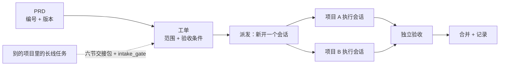

# AI 工作区套件（AI Workspace Kit）

English version: [README.en.md](README.en.md)

**你只跟一个 PM 提需求。它拆单、派活、盯回执、安排验收、QA 过后合并，没人管的活它自己巡航续上。**

[你的处境](#你的处境) · [你缺的是一个-pm](#你缺的是一个-pm) · [它替你做的四件事](#它替你做的四件事) · [能干什么](#能干什么六个场景) · [机制](#一张单的一生) · [装完先跑一遍](#装完先跑一遍) · [安装](#一键安装)

这套流程在一个真实项目里跑过几十张工单。现在把项目专属的内容去掉，剩下的部分打包给你。你只需要 Python 3.10，再有一个会读 `AGENTS.md` 的 agent。Cindy、Claude Code、Codex 都行。

---

## 你的处境

你同时开着几个项目、十几个会话。标题都差不多，昨天那个「改派发逻辑」在哪一条里，你点开三个才找到。

一个会话跑到一半问你「这里要不要兼容 Windows」。你在开会，没回。两天后它还停在那儿等，上下文已经凉了。

你让一个会话改前端，自己又开一个改接口。两边动了同一个文件，合的时候冲突，你得手工解，解完还不知道测试跑没跑。

你问「做完了？」，它说「已完成」。点开 diff 发现三个文件只改了一个。你没精力每次都核，于是慢慢变成「它说完成就算完成」。

你在手机上想推一下进度，得先想起这件事在哪个项目、哪个会话，然后一个个点进去看。

你想同时推进第四件事，但前三个已经在抢你的注意力。

这些事的共同点不是模型不够强。单拎出来，模型都做得来。共同点是：所有会话的路由、记忆、催办、质检都压在你一个人身上，而你的时间只有一份。

---

## 你缺的是一个 PM

把上面那些事归一下类，其实只有四种活：

- 决定这件事属于哪个项目、该派给谁；
- 记住每件事走到哪一步、下一步该谁；
- 有人停下来等的时候去推一把；
- 交付前检查一遍，别让「它说完成」直接变成「完成」。

这四件事有现成的名字：项目经理。一个 PM 每天做的就是接需求、拆活、派活、跟进、验收、汇报。

你以前没有这个人，是因为 agent 的工作单位是会话。会话是执行单元，不是管理单元：它会跑、会停、会等你，但它不记得别的会话在干什么，也不对你的项目负责。

这套工作区加的不是更强的 agent，是一层**项目层**：工单成了管理对象，会话退化成可替换的执行器。有了这一层，才可能出现一个稳定的 PM。

---

## 它替你做的四件事

### 拆活

需求进来先变成工单，写清交付什么、哪些不做、验收条件是什么。验收条件写不出来，说明这件事还没想清楚，就先不开工。每张单还要绑到一份带编号和版本的 PRD 上；PRD 改了，哈希对不上，旧成果自动失效，必须显式修订。

### 派活

它判断这件事属于哪个项目，派到那个项目的工作区，开一个新的执行会话，不用你动手翻列表。同一项目默认一次只跑一张单，急事并行要显式开 `allow_parallel`，免得几张单互相踩。

派活的难点不是找会话，是写清楚派什么。每张单交出去时，都带着刚好够用的上下文：

- **不会知道过多。** 执行会话只拿到这张单和它引用的那份 PRD，看不到别的项目，也不被无关的历史带偏。知道太多不是优势，它会越权、会顺手改不该改的东西。
- **不会知道过少。** 单子必须自包含到「换一个会话、换一个人也能直接开工」。所以工单要求写清交付物与不做什么，交接还要求六节包：用户原话、上次为什么不行、硬约束、已确认事实、未决问题。

这就像护士交班：只交关键信息，病人的状态、做了什么、下一步；但不能漏掉过敏史。多交是噪音，少交是事故。

上下文可控以后，执行单元才能换。换会话、换人、隔一周再来，拿到的还是同一张单，做的还是同一件事。

### 盯活

执行会话交回成果后，回执落在库里，它再决定下一环派给谁。需要你拍板的事走 `ask_ticket` 落库，不靠一张占住整轮的问答卡；你忙的时候它停在那里等人，配合宿主的定时任务，可以定期查工单状态，把该继续的活重新派下去。

验收是另一个会话做的。它只看单子和证据，不看执行时的聊天过程，所以判断干净。做的人不能给自己签字，这条没有开关。

### 收活

分支在开工时就规划好，一张单一棵工作树、一条 `ticket/<工单号>` 分支，主检出始终停在主分支上。QA 通过不等于进了主分支，合并只能走 `auto_merge.py`：核对工单状态与分支、预演冲突、打回退点、在临时工作树里跑测试，绿了才 `--no-ff` 合进去，合并后再跑一次测试才写回记录。中途红了自动回到合之前。

一轮结束也不是一句「做完了」：要写七节收尾包，由 `close_gate.py` 判断七节齐不齐、结论落在哪一档。

---

## 别的项目也能把活交进来

你在别的项目里做事，遇到跨多步、要交付、一轮做不完的活，不用自己一路做到黑，把事交给这个工作区就行。交接走固定协议：先写六节交接包，用 `intake_gate.py` 查缺节，再用四行消息新建一个工作区会话。原会话交完就停手，之后只向用户转述回执。

这条路在包里是齐的，装完就能用：

| 件 | 装到哪 | 作用 |
| --- | --- | --- |
| `handoff-to-workspace` 技能 | `~/.agents/skills/handoff-to-workspace/` | 告诉 agent 什么时候该交、交给谁、四步怎么做 |
| 交接协议正文 | `~/.agents/intake/intake.md` | 四行消息模板、六节结构与判据、落点选择 |
| `intake_gate.py` | `<工作区>/tools/intake_gate.py` | 缺节就非零退出，拒收不是靠自觉 |
| 项目定位与派发规则 | `AGENTS.md` 与 `project-routing`、`ticket-dispatch` 两个技能 | 项目归属不许猜；派发就是新开一个会话 |



---

## 能干什么：六个场景

| 你在做什么 | 用完之后会怎样 |
| --- | --- |
| 一个新功能从需求做到上线 | 需求带 PRD 版本，计划过闸门，执行与验收分开，合并前跑测试，库里留着完整记录 |
| 同时推进几个项目 | 一个中心库看所有项目的工单状态，不用翻各自的聊天记录 |
| 别的项目交来一件长线活 | 六节交接包过闸门，任务落进工作区；原会话停手，只向用户转述回执 |
| 需求中途改了 | 工单绑的 PRD 哈希对不上，提交被 `STALE_PRD` 挡住，必须显式修订 |
| 合并前心里没底 | `auto_merge` 预演冲突、跑测试、打回退点，红了自动回到合之前 |
| 隔天回来接着做 | 状态在库里，换会话、换人都能查到卡在哪、下一步该谁 |

---

## 一张单的一生

上面那些能力落到一张单上，是七步。每一步都写库，失败就非零退出。

**第一步，开工单。** `create_ticket` 要写清交付物（主题，以及明确不覆盖什么）和验收条件，绑定 PRD 版本。

**第二步，派发。** `claim_ticket` 之后，协调会话不能自己动手写成果。它必须新开一个会话，把任务派下去；用自己的标识去 `bind_session` 会被 `SELF_DISPATCH` 拒掉。

**第三步，执行。** 一张单一个 git 工作树、一条 `ticket/<工单号>` 分支。执行会话在 `.worktrees/<工单号>/` 里改，主检出不动。

**第四步，提交成果。** `submit_result` 要带成果文件、每个文件的 sha256，以及证据。提交之后工单进入 `awaiting_review`，执行会话停手。

**第五步，独立验收。** 换一个会话读工单、读证据，用 `review_result` 给结论：`accept` 或者 `rework`。

**第六步，合并。** 走 `auto_merge.py`，它按顺序核对状态、预演、测回滚点、跑测试，绿了才合。

**第七步，收尾。** 按 `docs/closing.md` 写七节收尾包，`close_gate.py` 判它过不过。

整条路上，工单状态都在 `ready → dispatching → running → awaiting_review → done` 这条链上。另外有两条旁支：需要人拍板时用 `ask_ticket` 把问题落库等人回答；决定返工时回到 `rework`，重新领一次。

---

## 它凭什么让你放心

规则写在文档里没人读，所以真正的约束放在退出码上。这些检查不是提醒，是默认会让操作失败：

| 检查 | 它拦什么 | 什么时候跑 |
| --- | --- | --- |
| `work_gate.py` | 没有工单就想提交；工单不属于本仓库；尝试没绑定或已经结束 | git commit 钩子，每次提交 |
| `doc_gate.py` | 计划没读 PRD、没写依据、缺节、完成证据不可判定 | 写在任务块里之前 |
| `close_gate.py` | 收尾包缺节、状态位没改、说有在途单其实没有 | 说「这一轮结束」之前 |
| `intake_gate.py` | 交给别人的长线任务，交接包缺节就想往下传 | 交接时 |
| `claims_gate.py` | 文档里写的数与源数据对不上：计数、合计、比例、摘要、字节数、行号锚点、清单条数 | 写结案材料与验收证据时 |
| `ref_gate.py` | 引用指向不存在的文件、行号或标题 | 文档之间互相引用时 |
| `run_tests.py` | 改完之后测试不全绿 | 提交前、合并前 |
| `auto_merge.py` | 想手工合并、想跳过测试合、想在有冲突时硬合 | 合并时 |

`auto_merge.py` 还有一条容易被忽略的规矩。合并提交是「没有工单也能提交」的唯一例外，因为合并发生在验收之后，那一刻工单已经是 `done`。其它提交一字不放。

---

## 为什么规则长这样

每一条都能追到一次具体的翻车。下面三次比较典型，只讲当时发生了什么。

**有一次，派发消息里写了一个会话标识，格式完全正确，库也照收了，但会话列表里根本没有这条。** 那个字符串是从临时目录名拼出来的。看记录像是完成了一次派发，实际指向不到任何会话。现在执行会话自己调 `get_current_session_id` 取标识，协调会话派发前用 `list_sessions` 反查标题与路径，查不到就不许绑定，也不许提交。

**另一次，执行会话提交了四条成果文件，sha256 全对不上。** 因为路径没带工作树前缀，库按项目根解析，算的是主检出里同名文件的哈希。数字本身没有错，错的是它指的那个文件。现在成果路径必须带 `.worktrees/<工单号>/` 前缀，验收时逐条核。

**还有一次，协调会话跳过了开单和派发，自己在协调会话里把成果做完了，然后自己宣布完成。** 记录看着很完整，但没有第二个人看过。现在 `SELF_DISPATCH` 会当场拒绝这种绑定，执行者与验收者的分离从约定变成了机制。

---

## 什么活该用它，什么活别用

它重。开一张单要走建单、领取、绑定、提交、验收五步。规划要过 `doc_gate`，提交要带工单号，收尾要过 `close_gate`。默认一次只跑一张单；急事要并行，得显式开 `allow_parallel`。人不到场拍板，决策就停在库里等人。

所以它值得用的是那种要交付、要能被别人复核、跨天跨会话还接得上的活。比如一个新功能、一次流程改造，或者一份要发给别人照着做的文档。

一次性小事、试个想法、临时脚本跑一下，直接说就行，套工作区是自找麻烦。

有个简单的判据：这件事两个月后还有人要问「当时是怎么定的、谁验的、凭什么合进去的」吗。要问，就走工作区；不问，就不必。

---

## 它和协同模式、subagent 不在一个层级

协同模式把「一个任务一个 agent」变成「一个 Lead 加若干 Worker」。Worker 是完整的独立任务，有自己的工作树和对话历史，可以并行跑，也可以派到同账号下另一台电脑。subagent 更轻，是进程内的一次性派发，跑完就结束。

这两者都在回答「谁在跑、活怎么派」。工作区回答的是另一个问题：这件事该不该现在做、做到什么算完、谁有权改文件、改完谁来验收、怎么合进主分支。

差别落在几个具体的地方。协同模式里，Lead 说做完了就是做完了，没有地方能判定真假；工作区里，执行者提交之后必须等另一个会话给结论。协同模式的 worktree 只解决别撞文件，怎么合进去不归它管；工作区的合并有预演、测试和回退点。协同模式的状态跟着会话走，会话归档就断了；工作区的状态在 SQLite 里，会话没了记录还在。

两层可以叠着用：用协同模式并行推进，每一路在自己的项目里走工作区流程。只是默认派发载体是「项目普通会话」，不是 Worker。执行会话要能点开追问，也要能自己提交成果；Worker 被 team 管着，team 归档之后就没了。

工作区现在最大的缺口也在这里。`claim_ticket` 之后「新建一个执行会话」这一步需要宿主能力，Cindy 里是 `send_to_session`，其他宿主需要自己补这一步或手工开会话再 `bind_session`。这件事写在 `AGENTS.md` 的「已知未实现」里，没有假装已经有了。

---

## 一键安装

要求：**Python 3.10+**；**Git** 建议装（没有也能用，只是少了「没工单不许提交」这道默认路径）。

```bash
git clone https://github.com/cazevfung/ai-workspace-kit ai-workspace-kit
cd ai-workspace-kit
python install.py
```

默认装到 `~/ai-workspace`，并把技能装到 `~/.agents/skills`（已存在的同名技能默认跳过，不覆盖你原来的配置）。常用参数：

```bash
python install.py --workspace D:/ai-ws        # 指定工作区目录
python install.py --dry-run                   # 只打印计划，不动任何文件
python install.py --overwrite-skills          # 用套件版本覆盖同名技能
python install.py --no-skills                 # 只装工作区，不动技能目录
python install.py --link-agents               # 顺带为 ~/.claude 与 ~/.codex 建技能链接
```

也可以用包装脚本：

```bash
powershell -ExecutionPolicy Bypass -File scripts/install.ps1   # Windows
bash scripts/install.sh                                        # macOS / Linux
```

安装器做六件事。它先复制工作区骨架，再装技能。接着写 `~/.agents/center.json` 与交接协议，初始化中心库并登记项目。最后 `git init` 做首次提交，提交完才启用钩子，然后打开提交闸门。装完照它打印的三条命令跑一遍即可。

### 安装后验证

```bash
cd ~/ai-workspace
python tools/work_gate.py --list     # 开工第一条命令
python tools/run_tests.py            # 应全绿
python tools/doc_gate.py --all       # 应退出 0
```

用例数以 `run_tests.py` 的汇总行为准，每个 tag 会变；`v0.3.0` 装出来是 453 项。

### 装完先跑一遍

`examples/demo.py` 用一个临时库把闭环走一遍：建工单、派发、提交、验收。它不连真实会话，也不写你的工作区，跑完临时库自动删掉。

```bash
cd ~/ai-workspace
PYTHONPATH=. python examples/demo.py            # macOS / Linux
$env:PYTHONPATH="."; python examples/demo.py    # Windows PowerShell
```

输出是每一步的真实回执。验收那一段值得看：第一次只交了一项，被判返工；补到两项才通过。

```text
{"operation": "review_result", "result": {"state": "rework", "reason": "只有一项，需要返工", ...}}
{"operation": "review_result", "result": {"state": "done", "reason": "满足两项要求", ...}}
```

上面是摘录，完整输出是逐行 JSON，最后一行写着「一次拒收、一次返工、一次通过」。

---

## 装了什么

```
ai-workspace/
├── AGENTS.md              # 行为契约：六条硬规则、消息通道、收尾、分支与合并
├── README.md
├── PRD/                   # 需求；每个成果都要报 PRD 编号与版本
├── tasks/                 # round.md（本轮目标）、rounds.md（历史）、plan-*.md
├── task_center/           # 工单核心（纯标准库，SQLite）
├── tools/                 # 闸门 + auto_merge + run_tests + 会话核对
├── tests/                 # 工单核心与闸门的用例
├── docs/                  # protocol / closing / probe / intake / skill-loading / claims-format
├── examples/
├── .agents/skills/        # 工作区技能
└── .githooks/             # commit 钩子
```

技能同时装在 `~/.agents/skills`（用户级），所以在**任何项目**里都能被 agent 读到。装完数一下 `~/.agents/skills` 下的目录就知道当前有几个，`v0.3.0` 是 25 个：

- **工作区技能（5）**：`prd-authoring`、`pdsa-workflow`、`ticket-dispatch`、`plan-gate`、`skill-routing`
- **通用技能（20）**：`brainstorming`、`writing-plans`、`executing-plans`、`test-driven-development`、
  `systematic-debugging`、`verification-before-completion`、`code-review-and-quality`、
  `requesting-code-review`、`receiving-code-review`、`merge-latest-branches`、`writing-skills`、
  `shuo-ren-hua`、`dispatching-parallel-agents`、`subagent-driven-development`、
  `resumable-implementation-contracts`、`using-git-worktrees`、`doubt-driven-development`、
  `planning-and-task-breakdown`、`project-routing`、`handoff-to-workspace`

工作区技能里最该先读的是 `skill-routing`：它把二十几个需要判断的节点各归到一个技能或一条固定动作，归口缺失或引用了不存在的技能，`scripts/check_routing.py` 会当场失败。

---

## 三种分发方式，为什么主推仓库

| 方式 | 适合谁 | 能装完整工作区吗 | 结论 |
| --- | --- | --- | --- |
| **GitHub 仓库 + `install.py`** | 所有人 | 能：代码、闸门、钩子、技能一次装齐 | **主渠道** |
| **技能包（SkillHub）** | 只想先试试的人 | 不能：技能只是说明，装不了 Python 包与钩子 | 入口：装完指向仓库 |
| **Cindy 插件** | 只用 Cindy 的人 | 不能：插件运行在沙箱里，改不了用户目录与 git 钩子 | 可选包装，非主渠道 |

完整分析见 [`docs/SHARING.md`](docs/SHARING.md)。一句话：这套东西的价值有一半在**文件系统**（工作树、提交钩子、本地库）上，插件与技能都碰不到那一半，所以仓库是唯一能装全的载体；另两种做成薄入口，负责把人带到仓库。

---

## 卸载

```bash
python uninstall.py --workspace ~/ai-workspace          # 删工作区（会二次确认）
python uninstall.py --skills                            # 只从 ~/.agents/skills 移除本套件的技能
```

默认**不删** `~/.agents/center.json` 和 `~/.agents/intake/`（可能还有别的项目在用），要一起删加 `--all`。工作区里的 `.data/` 是你的进度数据，卸载时默认保留。

---

## 维护者：把上游的更新同步进来

`kit/`、`skills/`、`design/` 来自一个上游工作区。上游改动之后，按三步重建，不要手工复制：

```bash
python maintainer/sync_from_origin.py        # 1. 从上游同步，并把绝对路径换成 {{WORKSPACE}}
python maintainer/redact_for_public.py       # 2. 清掉同步带进来的用户名、会话 id 与上游业务专名
python verify/verify_install.py              # 3. 临时目录里真装一遍，14 项全过再发版
```

第 2 步不能省：`kit/tests/fixtures` 是有意**原样复制**的（夹具里的绝对路径是判据的一部分），所以同步会把真实用户名和会话 id 一起带进来。`redact_for_public.py --check` 可以单独做发布前检查。

`README`、`install.py`、`uninstall.py`、`kit/AGENTS.md`、`kit/PRD/`、`docs/*.md` 是人工维护件，同步不会覆盖它们；上游规则改了要手工对齐。发版时记得升 `VERSION` 并写 `CHANGELOG.md`。

---

## 来源与许可

本套件的框架代码、闸门、技能与文档来自一个已稳定运行的个人 AI 工作区，经过去掉项目专属内容和本机绝对路径后整理而成。设计史（原始 PRD 与 AGENTS 记录）放在 `design/` 下，供想理解「为什么规则长这样」的人查阅。

MIT License，见 [`LICENSE`](LICENSE)。
