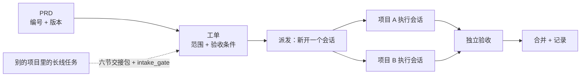

# AI 工作区套件（AI Workspace Kit）

English version: [README.en.md](README.en.md)

这套东西管一件事：AI 说自己做完了的时候，你能不能当场判断它是不是真的做完了。

它由三部分组成。数据库记工单与验收，只用标准库和 SQLite，在 `task_center/`。几道检查脚本在 `tools/`，条件不满足就非零退出。规则与技能在 `AGENTS.md` 和 `skills/` 里，写给 agent 看。

这套流程在一个真实项目里跑过几十张工单。现在把项目专属的内容去掉，剩下的部分打包给你。你只需要 Python 3.10，再有一个会读 `AGENTS.md` 的 agent。Cindy、Claude Code、Codex 都行。

---

## 它解决什么问题

你让 AI 连着做十步，最后它回你一句「已完成」。这句话里其实有三件事没被回答：这次到底要交付什么、这件事算在哪个项目上、凭什么说它做完了。

代码通常都在，缺的是能被别人查的记录。第二天你开了新会话，或者过两周同事接手，想弄清「当时为什么这么改、谁验的、为什么合进主分支」，只能翻聊天记录。聊天记录会滚走，库不会。

这套工作区把这三件事落成一个本地 SQLite：

- 工单记范围与验收条件；
- 尝试记哪条会话在做、绑在哪个工作树上；
- 提交记成果文件、sha256 与证据；
- 验收记结论、依据，以及是谁给的。

会话是可以丢的，库不会丢。这是设计里最基础的一条。

所以这套东西有两层。一层是流程：需求怎么进来、交给谁做、谁验收、怎么合进主分支。另一层是判定点：这条路上哪几步不许含糊，含糊了就当场报错。下面先讲流程，再讲判定点。

---

## 从需求到合并：它管的是整条线

一张单只是最小单位。真正有价值的是这条线：需求从 PRD 进来，评审过一道，派给合适的项目去做，做完由别人独立验收，合进主分支时留一条记录。人换了、会话换了、项目换了，这条线接得上。

这也是它和「把提示词写得更细」最不一样的地方。提示词管的是这一次回答得好不好；这套东西管的是十步之后你还能不能查到每一步是谁做的、凭什么过的。

**需求从 PRD 开始。** 每个项目有一份 PRD，带编号和版本号。工单的「依据」要写清用的是哪一版，验收条件从 PRD 里来，不是执行时临时编的。PRD 改了而工单没跟着改，提交会被 `STALE_PRD` 挡住，旧成果直接失效。这条规矩的意思是：需求变了要显式修订工单，不能让成果悄悄对不上需求。

**中间要过两次评审。** 第一次在动手前。PRD 要过 `prd-authoring` 技能的清单，计划要过 `doc_gate`。`doc_gate` 查三件事：有没有读 PRD，交付物和不做什么写没写清，完成证据能不能被机器判一次。第二次在交付后，换一个会话独立验收，执行的人不能给自己签字。

**工单可以派到不同项目。** 中心库一张表管所有项目：每个项目登记一个根目录，一张单属于一个项目，成果留在那个项目的仓库里。协调会话领单之后，把执行派到对应项目的工作区，验收也在那里做。项目归属不许猜，`probe` 只给候选，最终由人确认。

**别的项目可以反过来请这个工作区接管。** 任何项目里的会话遇到跨多步、要交付、一轮做不完的活，都可以把事交过来，而不是自己一路做到黑。交接走固定协议。先写六节交接包，内容是用户原话、要交付什么、上次为什么不行、硬约束、已确认的事实、未决问题。然后用 `intake_gate.py` 查缺节，再用四行消息新建一个工作区会话。

这条路在包里是齐的，装完就能用：

| 件 | 装到哪 | 作用 |
| --- | --- | --- |
| `handoff-to-workspace` 技能 | `~/.agents/skills/handoff-to-workspace/` | 告诉 agent 什么时候该交、交给谁、四步怎么做 |
| 交接协议正文 | `~/.agents/intake/intake.md` | 四行消息模板、六节结构与判据、落点选择 |
| `intake_gate.py` | `<工作区>/tools/intake_gate.py` | 缺节就非零退出，拒收不是靠自觉 |
| 项目定位与派发规则 | `AGENTS.md` 与 `project-routing`、`ticket-dispatch` 两个技能 | 项目归属不许猜；派发就是新开一个会话 |



交接之后原会话就停手，只向用户转述回执。反过来，收件方收到交接包的第一件事也是跑闸门，不是急着读 PRD。

这套安排换来四件事：

- **需求不会悄悄漂走。** PRD 有版本，工单绑着那一版；需求改了，旧成果自动失效，必须显式修订，没人能糊过去。
- **做事的人和判事的人分得开。** 执行会话不能自己验收，协调会话不能自己动手写成果，合并有独立脚本兜底。
- **多个项目共用一个账本。** 一个中心库里能查到每个项目在做什么、卡在哪一步、谁在做，不必去翻各自的聊天记录。
- **外面能接进来。** 别的项目遇到长线任务，写一份六节交接包就能交过来，不用手工搬上下文，也不会把「上次哪里不行」丢掉。

---

## 一张单的一生

下面这条路径就是这套东西的全部机制。每一步都由脚本写进库，失败就非零退出。

**第一步，开工单。** `create_ticket` 要写清交付物（主题，以及明确不覆盖什么）和验收条件。验收条件写不出来，说明这件事还没想清楚，就应该先想。

**第二步，派发。** `claim_ticket` 之后，协调会话不能自己动手写成果。它必须新开一个会话，把任务派下去，用自己的标识去 `bind_session` 会被 `SELF_DISPATCH` 拒掉。规则写成这样，是因为「自己派给自己」在别的流程里太容易发生了。

**第三步，执行。** 一张单一个 git 工作树、一条 `ticket/<工单号>` 分支。执行会话在 `.worktrees/<工单号>/` 里改，主检出始终停在主分支上，跑合并时不会把方向搞反。

**第四步，提交成果。** `submit_result` 要带成果文件、每个文件的 sha256，以及证据。提交之后工单进入 `awaiting_review`，执行会话到这里就停手。

**第五步，独立验收。** 换一个会话读工单、读证据，用 `review_result` 给结论：`accept` 或者 `rework`。执行的人不能给自己验收，这条没有开关。

**第六步，合并。** 验收通过不等于进了主分支。合并只能走 `tools/auto_merge.py`，它先核对四件事：工单是 `done`、还没有合并记录、当前检出不脏、源分支确实领先。核对通过之后，它预演一次冲突，打一个回退点，在临时工作树里跑一遍测试。测试绿了才 `--no-ff` 合进去，合并完再跑一次测试，通过才写回合并记录。中途红了就回到回退点，主分支一动没动。

**第七步，收尾。** 一轮结束不是一句「做完了」。要按 `docs/closing.md` 写七节收尾包。然后跑 `close_gate.py`，它检查七节齐不齐，也检查第 3 节是不是裸写「无」。结论还要落在三档之一：已收尾、等一句答复、需重开一轮。

整条路上，工单状态都在 `ready → dispatching → running → awaiting_review → done` 这条链上。另外有两条旁支：需要人拍板时用 `ask_ticket` 把问题落库等人回答；决定返工时回到 `rework`，重新领一次。

---

## 判定点：会真的拦人的地方

规则写在文档里没人读，所以真正的约束放在退出码上。这几道检查不是提醒，是默认会让操作失败：

| 检查 | 它拦什么 | 什么时候触发 |
| --- | --- | --- |
| `work_gate.py` | 没有工单就想提交；工单不属于本仓库；尝试没绑定或已经结束 | git commit 钩子，每次提交 |
| `doc_gate.py` | 计划没读 PRD、没写依据、缺节、完成证据不可判定 | 写在任务块里之前 |
| `close_gate.py` | 收尾包缺节、状态位没改、说有在途单其实没有 | 说「这一轮结束」之前 |
| `intake_gate.py` | 交给别人的长线任务，交接包缺节就想往下传 | 交接时 |
| `run_tests.py` | 改完之后测试不全绿 | 提交前、合并前 |
| `auto_merge.py` | 想手工合并、想跳过测试合、想在有冲突时硬合 | 合并时 |

`auto_merge.py` 还有一条容易被忽略的规矩。合并提交是「没有工单也能提交」的唯一例外，因为合并发生在验收之后，那一刻工单已经是 `done`。其它提交一字不放。

---

## 为什么规则长这样

每一条都能追到一次具体的翻车，不是凭空设计的。下面三次比较典型，只讲当时发生了什么。

**有一次，派发消息里写了一个会话标识，格式完全正确，库也照收了，但会话列表里根本没有这条。** 那个字符串是从临时目录名拼出来的。看记录像是完成了一次派发，实际指向不到任何会话，比写一个明显的假值更难发现。现在的要求分两头。执行会话自己调 `get_current_session_id` 取标识，不拼、不缩写。协调会话派发前用 `list_sessions` 按工作目录反查标题与路径，查不到就不许绑定，也不许提交。

**另一次，执行会话提交了四条成果文件，sha256 全对不上。** 因为提交时路径没带工作树前缀，库按项目根解析，算的是主检出里同名文件的哈希。数字本身没有错，错的是它指的那个文件。现在成果路径必须带 `.worktrees/<工单号>/` 前缀，验收时按这个路径逐条核。

**还有一次，协调会话跳过了开单和派发，自己在协调会话里把成果做完了，然后自己宣布完成。** 记录看着很完整，但没有第二个人看过。现在 `SELF_DISPATCH` 会当场拒绝这种绑定，执行者与验收者的分离从「约定」变成了「机制」。

---

## 什么活该用它，什么活别用

它重。开一张单要走建单、领取、绑定、提交、验收五步。规划要过 `doc_gate`，提交要带工单号，收尾要过 `close_gate`。默认一次只跑一张单，同项目已有在途工单时 `claim_ticket` 会报 `DISPATCH_BUSY`；急事要并行，得显式开 `allow_parallel`。人不到场拍板，决策就停在库里等人。

所以它值得用的是那种要交付、要能被别人复核、跨天跨会话还接得上的活。比如一个新功能、一次流程改造，或者一份要发给别人照着做的文档。

一次性小事、试个想法、临时脚本跑一下，直接说就行，套工作区是自找麻烦。

有个简单的判据：这件事两个月后还有人要问「当时是怎么定的、谁验的、凭什么合进去的」吗。要问，就走工作区；不问，就不必。

---

## 它和协同模式、subagent 不在一个层级

这三件事经常被混着说，其实解决的是不同问题。

协同模式把「一个任务一个 agent」变成「一个 Lead 加若干 Worker」。Worker 是完整的独立任务，有自己的工作树和对话历史。它们可以并行跑，也可以派到同账号下另一台电脑。subagent 更轻，是进程内的一次性派发，跑完就结束。

这两者都在回答「谁在跑、活怎么派」。工作区回答的是另一个问题：这件事该不该现在做、做到什么算完、谁有权改文件、改完谁来验收、怎么合进主分支。

差别落在几个具体的地方。协同模式里，Lead 说做完了就是做完了，没有地方能判定真假；工作区里，执行者提交之后必须等另一个会话给结论。协同模式的 worktree 只解决别撞文件，怎么合进去不归它管；工作区的合并有预演、测试和回退点。协同模式的状态跟着会话走，会话归档就断了；工作区的状态在 SQLite 里，会话没了记录还在。

两层可以叠着用：用协同模式并行推进，每一路在自己的项目里走工作区流程。只是默认派发载体是「项目普通会话」，不是 Worker。执行会话要能点开追问，也要能自己提交成果；Worker 被 team 管着，team 归档之后就没了。

工作区现在最大的缺口也在这里。`claim_ticket` 之后「新建一个执行会话」这一步还没有自动适配层，目前是协调会话手工调 `send_to_session`。这件事写在 `AGENTS.md` 的「已知未实现」里，没有假装已经有了。

---

## 一键安装

要求：**Python 3.10+**；**Git** 建议装（没有也能用，只是少了「没工单不许提交」这道默认路径）。

```bash
git clone https://github.com/cazevfung/ai-workspace-kit ai-workspace-kit
cd ai-workspace-kit
python install.py
```

默认装到 `~/ai-workspace`，并把技能装到 `~/.agents/skills`（已存在的同名技能默认跳过，不覆盖你原来的配置）。常用参数：

```bash
python install.py --workspace D:/ai-ws        # 指定工作区目录
python install.py --dry-run                   # 只打印计划，不动任何文件
python install.py --overwrite-skills          # 用套件版本覆盖同名技能
python install.py --no-skills                 # 只装工作区，不动技能目录
python install.py --link-agents               # 顺带为 ~/.claude 与 ~/.codex 建技能链接
```

也可以用包装脚本：

```bash
powershell -ExecutionPolicy Bypass -File scripts/install.ps1   # Windows
bash scripts/install.sh                                        # macOS / Linux
```

安装器做六件事。它先复制工作区骨架，再装技能。接着写 `~/.agents/center.json` 与交接协议，初始化中心库并登记项目。最后 `git init` 做首次提交，提交完才启用钩子，然后打开提交闸门。装完照它打印的三条命令跑一遍即可。

### 安装后验证

```bash
cd ~/ai-workspace
python tools/work_gate.py --list     # 开工第一条命令
python tools/run_tests.py            # 应全绿
python tools/doc_gate.py --all       # 应退出 0
```

用例数以 `run_tests.py` 的汇总行为准，每个 tag 会变；`v0.2.1` 装出来是 381 项。

---

## 装了什么

```
ai-workspace/
├── AGENTS.md              # 行为契约：六条硬规则、消息通道、收尾、分支与合并
├── README.md
├── PRD/                   # 需求；每个成果都要报 PRD 编号与版本
├── tasks/                 # round.md（本轮目标）、rounds.md（历史）、plan-*.md
├── task_center/           # 工单核心（纯标准库，SQLite）
├── tools/                 # 闸门 + auto_merge + run_tests + 会话核对
├── tests/                 # 工单核心与闸门的用例
├── docs/                  # protocol / closing / probe / intake / skill-loading
├── examples/
├── .agents/skills/        # 工作区技能
└── .githooks/             # commit 钩子
```

技能同时装在 `~/.agents/skills`（用户级），所以在**任何项目**里都能被 agent 读到。装完数一下 `~/.agents/skills` 下的目录就知道当前有几个，`v0.2.1` 是 25 个：

- **工作区技能（5）**：`prd-authoring`、`pdsa-workflow`、`ticket-dispatch`、`plan-gate`、`skill-routing`
- **通用技能（20）**：`brainstorming`、`writing-plans`、`executing-plans`、`test-driven-development`、
  `systematic-debugging`、`verification-before-completion`、`code-review-and-quality`、
  `requesting-code-review`、`receiving-code-review`、`merge-latest-branches`、`writing-skills`、
  `shuo-ren-hua`、`dispatching-parallel-agents`、`subagent-driven-development`、
  `resumable-implementation-contracts`、`using-git-worktrees`、`doubt-driven-development`、
  `planning-and-task-breakdown`、`project-routing`、`handoff-to-workspace`

工作区技能里最该先读的是 `skill-routing`：它把二十几个需要判断的节点各归到一个技能或一条固定动作，归口缺失或引用了不存在的技能，`scripts/check_routing.py` 会当场失败。

---

## 三种分发方式，为什么主推仓库

| 方式 | 适合谁 | 能装完整工作区吗 | 结论 |
| --- | --- | --- | --- |
| **GitHub 仓库 + `install.py`** | 所有人 | 能：代码、闸门、钩子、技能一次装齐 | **主渠道** |
| **技能包（SkillHub）** | 只想先试试的人 | 不能：技能只是说明，装不了 Python 包与钩子 | 入口：装完指向仓库 |
| **Cindy 插件** | 只用 Cindy 的人 | 不能：插件运行在沙箱里，改不了用户目录与 git 钩子 | 可选包装，非主渠道 |

完整分析见 [`docs/SHARING.md`](docs/SHARING.md)。一句话：这套东西的价值有一半在**文件系统**（工作树、提交钩子、本地库）上，插件与技能都碰不到那一半，所以仓库是唯一能装全的载体；另两种做成薄入口，负责把人带到仓库。

---

## 卸载

```bash
python uninstall.py --workspace ~/ai-workspace          # 删工作区（会二次确认）
python uninstall.py --skills                            # 只从 ~/.agents/skills 移除本套件的技能
```

默认**不删** `~/.agents/center.json` 和 `~/.agents/intake/`（可能还有别的项目在用），要一起删加 `--all`。工作区里的 `.data/` 是你的进度数据，卸载时默认保留。

---

## 维护者：把上游的更新同步进来

`kit/`、`skills/`、`design/` 来自一个上游工作区。上游改动之后，按三步重建，不要手工复制：

```bash
python maintainer/sync_from_origin.py        # 1. 从上游同步，并把绝对路径换成 {{WORKSPACE}}
python maintainer/redact_for_public.py       # 2. 清掉同步带进来的用户名与会话 id
python verify/verify_install.py              # 3. 临时目录里真装一遍，13 项全过再发版
```

第 2 步不能省：`kit/tests/fixtures` 是有意**原样复制**的（夹具里的绝对路径是判据的一部分），所以同步会把真实用户名和会话 id 一起带进来。`redact_for_public.py --check` 可以单独做发布前检查。

`README`、`install.py`、`uninstall.py`、`kit/AGENTS.md`、`kit/PRD/`、`docs/*.md` 是人工维护件，同步不会覆盖它们；上游规则改了要手工对齐。发版时记得升 `VERSION` 并写 `CHANGELOG.md`。

---

## 来源与许可

本套件的框架代码、闸门、技能与文档来自一个已稳定运行的个人 AI 工作区，经过去掉项目专属内容和本机绝对路径后整理而成。设计史（原始 PRD 与 AGENTS 记录）放在 `design/` 下，供想理解「为什么规则长这样」的人查阅。

MIT License，见 [`LICENSE`](LICENSE)。
